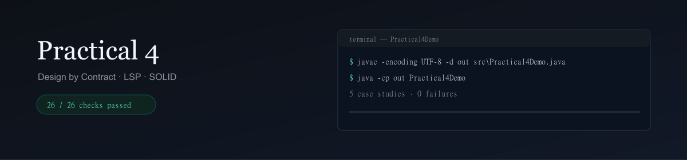

# Practical 4 — Advanced Object-Oriented Programming

**Design by Contract · Liskov Substitution Principle · sealed hierarchies · SOLID**

This folder contains the Practical 4 submission and its execution evidence. The work is a standalone Java case-study program, kept separate from the LifeLink application. It was compiled and run locally with Java 25 LTS; 26 checks ran with 0 failures.

> Scope note: this is a course practical. It does not use LifeLink application data, endpoints, or screenshots.

| Section | Link |
| :--- | :--- |
| Student information | [Details](#student-information) |
| Case studies | [Case studies](#case-studies) |
| Evidence | [Execution evidence](#execution-evidence) |
| How to rerun | [Rerun locally](#rerun-locally) |
| Files | [Folder contents](#folder-contents) |
| Main project | [LifeLink README](../../README.md) |

---

## Student information

| Field | Details |
| :--- | :--- |
| **Student name** | Karkala Shiva Reddy |
| **Student ID** | 2520030105 |
| **Course** | Advanced Object-Oriented Programming |
| **Practical** | Practical 4 |
| **Runtime used for evidence** | Java 25 LTS (`25+37-LTS-3491`) |
| **Verification result** | PASS — 26 checks, 0 failures |
| **Verified on** | 24 November 2026 |

---

## Case studies

| # | Topic | What the program demonstrates |
| :--- | :--- | :--- |
| 1 | Design by Contract | `FirstFitAllocator`, `LowestOccupancyZoneAllocator`, and `NearestEntryAllocator` satisfy the allocator contract. `SaboteurAllocator` is an intentional negative control; the shared suite detects its precondition and postcondition violations. |
| 2 | Liskov Substitution Principle | `SavingsAccount`, `CurrentAccount`, and two `FixedDepositAccount` instances are used through `BankAccount`. The immature fixed deposit declines withdrawal instead of throwing. |
| 3 | Sealed / abstract / interface design | Four permitted `Course` implementations register and grade through the same contract. Exhaustive pattern matching handles each kind; `AbstractCourse` is only a shared base. |
| 4 | Contract testing and debugging | `CreditCardProcessor`, `UpiProcessor`, and `NetBankingProcessor` pass. `DefectiveProcessor` is an intentional negative control that is detected for an unexpected exception, blank receipt ID, and altered amount. |
| 5 | Cost of change / SOLID | `ScanService` is added through registration without editing the workflow. All three services run, and `AuditObserver` records the events. |

The negative-control classes are deliberately invalid implementations used to prove that the checks detect violations. Passing the suite means detection worked, not that those classes are valid.

---

## Execution evidence

| Check | Recorded result |
| :--- | :--- |
| Compilation | `javac -encoding UTF-8 -d out src\Practical4Demo.java` exited 0 |
| Execution | `java -cp out Practical4Demo` exited 0 |
| Checks | 26 run, 0 failed, result PASS |
| Terminal output | [VSCODE_OUTPUT.txt](VSCODE_OUTPUT.txt) contains the exact commands and full stdout |
| Editor capture | [VSCODE_EDITOR.png](VSCODE_EDITOR.png) — real 1600×1000 VS Code capture |
| Terminal capture | [VSCODE_TERMINAL.png](VSCODE_TERMINAL.png) — real 1600×1000 VS Code capture |
| Notes | [EVIDENCE_NOTES.md](EVIDENCE_NOTES.md) |
| Verification record | [PRACTICAL-4 - VERIFICATION.txt](PRACTICAL-4%20-%20VERIFICATION.txt) |
| Submission | [Practical-4.pdf](Practical-4.pdf), [Practical-4.docx](Practical-4.docx) |

The PDF follows the same format as Practical 1–3: left-aligned roll number with KLH logo at top right, title and italic subtitle, Times New Roman body, Consolas code/output, answers Q1–Q5, Program Output, VS Code Execution, and two real figures. It contains no application screenshots or unrelated project content.

---

## Rerun locally

From this folder:

```powershell
javac -encoding UTF-8 -d out src\Practical4Demo.java
java -cp out Practical4Demo
```

The `out/` directory is generated build output and is intentionally ignored by Git. The Java source is the single implementation file at `src/Practical4Demo.java`.

---

## Folder contents

| Path | Purpose |
| :--- | :--- |
| [src/Practical4Demo.java](src/Practical4Demo.java) | All five case studies and their shared check runner |
| [Practical-4.pdf](Practical-4.pdf) | Final 8-page submission PDF |
| [Practical-4.docx](Practical-4.docx) | Editable submission source |
| [EVIDENCE_NOTES.md](EVIDENCE_NOTES.md) | Execution and classification notes |
| [PRACTICAL-4 - VERIFICATION.txt](PRACTICAL-4%20-%20VERIFICATION.txt) | Format, execution, screenshot, and PDF checks |
| [VSCODE_OUTPUT.txt](VSCODE_OUTPUT.txt) | Exact terminal commands and stdout |
| [VSCODE_EDITOR.png](VSCODE_EDITOR.png) | Editor screenshot |
| [VSCODE_TERMINAL.png](VSCODE_TERMINAL.png) | Terminal screenshot |
| [KLH_LOGO.png](KLH_LOGO.png) | Logo used in the submission format |
| [assets/](assets/) | Original locally generated README banner and poster |

---

## Academic integrity

All case-study implementations here are original work prepared for the course. The screenshots are real captures from the local verification run. No third-party assignment solution, invented result, or LifeLink project content is included in this practical.

The animated banner is original local artwork generated by [`../../project/frontend/scripts/build-readme-assets.mjs`](../../project/frontend/scripts/build-readme-assets.mjs).

---

## Author

**Karkala Shiva Reddy**

Student ID: **2520030105**

GitHub: [@karkalashivareddy](https://github.com/karkalashivareddy)

Return to the [main project README](../../README.md).
