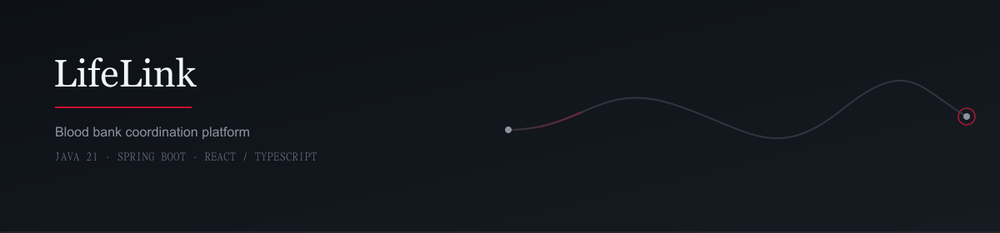

# LifeLink — Advanced Object-Oriented Programming Project

**Java Spring Boot backend · React/TypeScript web client**

[](#)
[](#)
[](#)
[](#)

LifeLink coordinates donor profiles, donation screening, blood-unit inventory, hospital requests, allocation and reservation workflows, dispatch, notifications, audit records, and scoped analytics. The Java backend owns every business rule; the React client presents those verified workflows through a responsive web interface.

> This repository documents an implemented academic project and its local verification. It is not a production deployment.

| Section | Link |
| :--- | :--- |
| Student information | [Details](#student-information) |
| Project overview | [Overview](#project-overview) |
| Architecture | [Architecture](#architecture) |
| AOOP concepts | [Concept mapping](#aoop-concepts-demonstrated) |
| Run locally | [Getting started](#getting-started) |
| Verification | [Evidence](#verification-evidence) |
| Documentation | [Deliverables](#documentation-and-deliverables) |
| Lab work | [Practical 4 README](LAB-WORK/PRACTICAL-4/README.md) |

---

## Student information

| Field | Details |
| :--- | :--- |
| **Student name** | Karkala Shiva Reddy |
| **Student ID** | 2520030105 |
| **Subject** | Advanced Object-Oriented Programming |
| **Project title** | LifeLink — Blood Bank Coordination Platform |
| **Repository** | [Advanced-Object-Oriented-Programming-Project](https://github.com/karkalashivareddy/Advanced-Object-Oriented-Programming-Project) |
| **Implementation status** | Implemented and verified locally |
| **Last reviewed** | 27 November 2026 |

The abstract submission form also lists additional team members and administrative fields. Those fields remain in the corrected abstract source; any roster discrepancy requires human confirmation and is not silently changed here.

---

## Project overview

The domain path is **donor → donation → inventory → request → allocation → reservation → dispatch → delivery**. Each transition is enforced in Java services and domain entities, not in the browser.

The application is a modular Java monolith with a separate static web client:

- **Java 21 / Spring Boot 3.5.16** owns entities, invariants, validation, transactions, authorization decisions, repository queries, and analytics calculations.
- **React 19 / TypeScript 5.9 / Vite 7** provides forms, tables, charts, role-aware navigation, loading and empty states, and reduced-motion support.
- **PostgreSQL 16** is the development database, managed by Flyway migrations `V1`–`V6`.
- **REST `/api/v1`** is the client/server contract. Authenticated **SockJS/STOMP over `/ws`** invalidates notification caches; the REST inbox remains authoritative.

Java is the primary implementation language for the AOOP assessment. React/TypeScript is retained by project decision for the web interface; the application is not described as Java-only or Vaadin-based.

---

## Architecture

| Area | Selection |
| :--- | :--- |
| Backend language | Java 21 |
| Backend framework | Spring Boot 3.5.16 — Web MVC, Security, Data JPA/Hibernate, Validation, WebSocket/STOMP, Actuator, springdoc OpenAPI |
| Frontend | React 19, TypeScript 5.9, Vite 7.3, React Router 7, TanStack Query 5, Recharts 3, SockJS + STOMP.js, lucide-react, self-hosted Fraunces/Geist/Geist Mono variable fonts |
| Database | PostgreSQL 16 via Docker Compose; H2 PostgreSQL mode and Testcontainers PostgreSQL in tests |
| Migrations | Flyway `V1`–`V6` with Hibernate `ddl-auto=validate` |
| Build | Maven Wrapper 3.9.11 (`project/backend`), npm (`project/frontend`) |
| Tests | JUnit 5, Mockito, Spring Boot Test, Testcontainers, Vitest, Playwright |
| Local runtime | Docker Compose: PostgreSQL, Spring Boot backend, nginx-served SPA |

```text
Advanced-Object-Oriented-Programming-Project/
├── README.md                         # This overview
├── LAB-WORK/                         # Course lab work, including Practical 4
│   └── PRACTICAL-4/README.md         # Practical 4 evidence and case studies
└── project/
    ├── backend/                      # Java 21 / Spring Boot Maven application
    │   └── src/main/java/com/lifelink/
    ├── frontend/                     # React/TypeScript Vite SPA
    │   ├── src/
    │   ├── e2e/
    │   ├── scripts/
    │   └── docs/
    ├── docker/                       # Local Compose stack
    └── docs/                         # Architecture, academic mapping, evidence, reviews
```

---

## AOOP concepts demonstrated

| Concept | Where it appears |
| :--- | :--- |
| Encapsulation | `BloodUnit`, `EmergencyRequest`, `Reservation`, `Dispatch` expose guarded transition methods |
| Inheritance | JPA aggregates extend `BaseEntity`; `LifeLinkException` heads the typed exception hierarchy |
| Polymorphism | Interchangeable `AllocationStrategy` and `CompatibilitySpecification` implementations |
| Abstraction / interfaces | Repositories, strategies, notification channels, and DTO records |
| Exception handling | `GlobalExceptionHandler` maps typed exceptions to stable API error codes |
| Collections and generics | `List<BloodUnit>`, `Set<Long>`, `Page<T>`, `Specification<T>`, typed API envelopes |
| Design patterns | Repository, Strategy, Specification, DTO, Transactional Outbox, Idempotency Key |
| Separation of concerns | Controllers, services, domain entities, repositories, security configuration, DTOs |

Class-by-class evidence is in [AOOP concept mapping](project/docs/academic/AOOP_CONCEPT_MAPPING.md).

---

## Getting started

### Prerequisites

- JDK 21 — the Maven Wrapper downloads Maven 3.9.11
- Node.js 24 and npm 11
- Docker Desktop / Docker Compose for the PostgreSQL-backed stack
- PowerShell on Windows, or an equivalent shell

### Run the complete local stack

```powershell
$env:JWT_SECRET = '<generate-a-long-random-development-secret>'
docker compose -f project/docker/docker-compose.yml up -d --build
```

| Service | URL |
| :--- | :--- |
| SPA | `http://127.0.0.1:15173` |
| Backend health | `http://127.0.0.1:18080/actuator/health` |
| PostgreSQL | `127.0.0.1:15432` |

Demo seed accounts are development fixtures only; see the [user guide](project/docs/user-guide/USER_GUIDE.md). Do not enable them outside a local or demo profile.

### Checks

```powershell
cd project/backend
.\mvnw.cmd test
```

```powershell
cd project/frontend
npm ci
npm run typecheck
npm test
npm run build
npm audit --audit-level=high
```

With the Compose backend available:

```powershell
cd project/frontend
$env:VITE_API_PROXY_TARGET = 'http://127.0.0.1:18080'
npm run test:e2e
```

---

## Verification evidence

| Gate | Recorded result |
| :--- | :--- |
| Backend suite | `.\mvnw.cmd -B -ntp test` — 135 tests run, 0 failures, 0 errors, 8 skipped. Skips are Docker-dependent PostgreSQL Testcontainers classes because the Docker daemon was unavailable in the final workspace. |
| Frontend unit suite | 55 tests in 11 files passed; strict TypeScript typecheck and Vite production build passed. |
| Browser tests | 46 Playwright executions passed across Chrome and Edge, including authentication, bounded server-side search, role workflows, mobile focus behaviour, overflow checks, STOMP plus REST polling, forced colors, reduced motion, and accessibility scans. |
| UI audit | 45 runs passed with 0 console errors, 0 warnings, 0 failed requests, and CLS below 0.05 at five viewports. |
| Accessibility | Axe WCAG A/AA checks reported zero violations on audited public and workspace routes. This is route-level evidence, not full conformance. |
| Local stack | H2 development server applied Flyway `V1`–`V6`, seeded demo data, and returned HTTP 200 `UP`. |

Full commands, evidence links, and limitations are in [test results](project/docs/quality/TEST_RESULTS.md) and the [final design/motion report](project/frontend/docs/FINAL_REPORT.md). Lighthouse was not run because it is not installed and adding it would exceed the approved dependency set.

---

## Documentation and deliverables

- [Corrected abstract PDF](project/docs/abstract/LifeLink_Project_Abstract.pdf)
- [Editable abstract source](project/docs/abstract/LifeLink_Project_Abstract.docx)
- [Abstract validation evidence](project/docs/evidence/ABSTRACT_PDF_VALIDATION.json)
- [Project proposal](project/docs/proposal/PROJECT_PROPOSAL.md)
- [System architecture](project/docs/architecture/SYSTEM_ARCHITECTURE.md)
- [API contracts](project/docs/architecture/API_CONTRACTS.md)
- [Domain model](project/docs/architecture/DOMAIN_MODEL.md)
- [UML and workflows](project/docs/architecture/UML.md)
- [AOOP concept mapping](project/docs/academic/AOOP_CONCEPT_MAPPING.md)
- [User guide](project/docs/user-guide/USER_GUIDE.md)
- [Deployment guide](project/docs/deployment/DEPLOYMENT_GUIDE.md)
- [Test results](project/docs/quality/TEST_RESULTS.md)
- [Known limitations](project/docs/quality/KNOWN_LIMITATIONS.md)
- [Product and engineering research](project/docs/reviews/LIFELINK_PRODUCT_AND_ENGINEERING_RESEARCH.md)
- [Full repository audit](project/docs/reviews/LIFELINK_FULL_REPOSITORY_AUDIT.md)
- [AOOP implementation map](project/docs/reviews/AOOP_IMPLEMENTATION_MAP.md)
- [Browser evidence](project/docs/evidence/)
- [Lab work — Practical 4](LAB-WORK/PRACTICAL-4/README.md)

---

## Academic integrity

This repository contains original academic work prepared for the Advanced Object-Oriented Programming course. Course reference material under `LAB-WORK/` is preserved separately from the LifeLink application. External libraries and frameworks are used under their published licences. Demo credentials are local development fixtures and must not be used in production.

The animated banners in this README and the lab-work README are original local artwork generated by [`project/frontend/scripts/build-readme-assets.mjs`](project/frontend/scripts/build-readme-assets.mjs). They contain no third-party photography or invented claims.

---

## Author

**Karkala Shiva Reddy**

Student ID: **2520030105**

GitHub: [@karkalashivareddy](https://github.com/karkalashivareddy)
