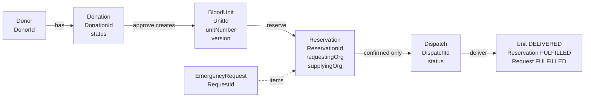

# LifeLink Domain Model

**Status:** Planned domain design; no implementation is claimed.  
**Authority:** Enum literals, endpoints, and view fields follow [`API_CONTRACTS.md`](API_CONTRACTS.md). Aggregate and transition rules here are the source of truth for [`UML.md`](UML.md) and `../academic/AOOP_CONCEPT_MAPPING.md`.

---

## 1. Aggregate boundaries

| Aggregate root | Contains | Consistency rule owned by the root | Boundary justification |
| :--- | :--- | :--- | :--- |
| `Organization` | `Membership`, address/contact value data | Only a verified, active organization may supply stock | Organization identity and verification are changed together. |
| `User` (identity) | `RefreshToken`, role/permission claims snapshot | A disabled or locked user cannot obtain or use a token | Credential state belongs with the user. |
| `Donor` | `Consent`, `Appointment` | A donor's own consents/appointments are reached through the donor | Appointments are read through `Donor`, but are separate roots for staff scheduling. |
| `Donation` | `ScreeningResult`, unit references (`UnitId`) | Approval requires a passed screening; approval creates units | The screening-to-approval rule lives in one object. Units are separate roots because inventory has its own lifecycle and locking. |
| `BloodUnit` | `Movement`, storage location, version | No release/reserve/dispatch outside its state machine; one active reservation | The unit is the concurrency hotspot and must be lockable alone. |
| `EmergencyRequest` | `RequestItem`, request events | Approval requires at least one item; fulfilment requires all items delivered | Request items have no lifecycle apart from the request. |
| `Reservation` | expiry policy, `UnitId`, org ids | One hold per unit; cancel releases the unit | Reservation owns the timeout and the unit relationship. |
| `Dispatch` | recipient name, incident log | At most one dispatch per reservation | Delivery/tracking state belongs with dispatch. |
| `Notification` | read state | Only the owner can mark read | Inbox entry is independent per user. |
| `AuditLog` | — | Append-only | Never mutated; a new entry is added instead. |

**Rule:** references across aggregates are typed identifiers only. `Donation` stores `List<UnitId>`, not embedded `BloodUnit` JPA entities; `Reservation` stores `UnitId`, `RequestId`, `requestingOrganizationId`, and `supplyingOrganizationId`.

## 2. Entities

| Entity | Identity | Key fields | Notes |
| :--- | :--- | :--- | :--- |
| `User` | `UserId` + `publicId` | `email`, `fullName`, `phone`, `status`, roles, permissions, memberships | `UserView` exposes `id`, `publicId`, `email`, `fullName`, `status`, `roles`, `permissions`, `memberships`. |
| `Organization` | `OrganizationId` + `publicId` | `name`, `type`, `registrationCode`, `city`, `state`, `contactEmail`, `phone`, `verified`, `active`, `serviceArea` | Mirrors `OrganizationView`. |
| `Donor` | `DonorId` + `publicId` | `fullName`, `bloodGroup`, `dateOfBirth`, `contact`, `organizationId`, `userId` | Owner or `DONOR_READ` may read. |
| `Consent` | `ConsentId` | `donorId`, `purpose`, `grantedAt`, `revokedAt?` | Append-only decision record. |
| `Appointment` | `AppointmentId` | `donorId`, `organizationId`, `requestedFor`, `status`, `notes` | Status transitions in §6.5. |
| `Donation` | `DonationId` | `donorId`, `organizationId`, `AppointmentId?`, `collectedAt`, `status`, `screeningResult?`, `rejectionReason?` | Approve produces units. |
| `BloodUnit` | `UnitId` + `publicId` + `unitNumber` | `bloodGroup`, `componentType`, `status`, `released`, `collectedAt`, `expiresAt`, `storageLocation`, `organizationId`, `donationId?`, `version` | Exactly the fields of `BloodUnitView`. |
| `EmergencyRequest` | `RequestId` + `publicId` | `requestingOrganizationId`, `priority`, `status`, items, `requestedBy`, timestamps | Status values in §6.2. |
| `RequestItem` | `RequestItemId` | `bloodGroup`, `componentType`, `requiredQuantity`, `fulfilledQuantity`, `neededBy` | Local to the request aggregate. |
| `Reservation` | `ReservationId` + `publicId` | `unitId`, `requestId?`, `requestingOrganizationId`, `supplyingOrganizationId`, `status`, `expiresAt`, `idempotencyKey` | idempotency required on creation paths. |
| `Dispatch` | `DispatchId` + `publicId` | `reservationId`, `unitId`, `status`, `recipientName?`, `incidents`, timestamps | Created only from a confirmed reservation. |
| `Notification` | `NotificationId` | `userId`, `eventId`, `type`, `message`, `read`, `createdAt` | Unique on `(userId, eventId)`. |
| `AuditLog` | `AuditLogId` | `actorId`, `action`, `targetType`, `targetId`, `organizationId`, `outcome`, `correlationId`, `occurredAt` | Immutable. |

## 3. Value objects

All are immutable, validate in their constructor, use value equality, and expose no setters. This directly applies the invariant-doorway lessons from `LAB-WORK/PRACTICAL-2` and `PRACTICAL-3`.

| Value object | Fields / representation | Validation and meaning |
| :--- | :--- | :--- |
| `OrganizationId`, `UserId`, `DonorId`, `DonationId`, `UnitId`, `RequestId`, `ReservationId`, `DispatchId` | typed `long` wrappers | Positive value required; prevents passing a `UnitId` where a `ReservationId` is expected. |
| `BloodGroup` | enum | The eight literals from the contract; no free text. |
| `ComponentType` | enum | The five literals from the contract. |
| `UnitStatus` | enum | The nine literals from the contract. |
| `StorageLocation` | `bankSite`, `rack`, `shelf` | Nonblank parts; changes produce a `Movement`. |
| `ExpiryWindow` | `collectedAt`, `expiresAt` (UTC) | `expiresAt` strictly after `collectedAt`; used by `expiringWithinDays` filter. |
| `BloodRequirement` | `BloodGroup`, `ComponentType`, `quantity` | Quantity positive; used by request items and allocation specifications. |
| `ScreeningResult` | `passed`, `notes`, `reviewedBy`, `reviewedAt` | Notes required when `passed == false`; immutable. |
| `RejectionReason` | nonblank text | Required by donation and request rejection. |
| `RecipientName` | nonblank text | Required by dispatch delivery. |
| `IdempotencyKey` | nonblank text, max length | Stored once per `(scope, key)`; replay returns the original response. |
| `CorrelationId` | nonblank text | Propagated to logs, errors, audit, and outbox. |
| `Permission` / `Role` | enum/string constants | Names match the contract exactly. |
| `AuditActor`, `AuditOutcome` | typed id + enum | Actor is a value, not a mutable user reference. |

## 4. Enums (contract literals)

| Enum | Literals |
| :--- | :--- |
| `Role` | `PLATFORM_ADMIN`, `BLOOD_BANK_ADMIN`, `INVENTORY_MANAGER`, `HOSPITAL_ADMIN`, `MEDICAL_STAFF`, `DONOR` |
| `UserStatus` | `ACTIVE`, `PENDING_VERIFICATION`, `LOCKED`, `DISABLED` |
| `OrganizationType` | `BLOOD_BANK`, `HOSPITAL` |
| `BloodGroup` | `A_POSITIVE`, `A_NEGATIVE`, `B_POSITIVE`, `B_NEGATIVE`, `AB_POSITIVE`, `AB_NEGATIVE`, `O_POSITIVE`, `O_NEGATIVE` |
| `ComponentType` | `WHOLE_BLOOD`, `RED_CELLS`, `PLASMA`, `PLATELETS`, `CRYOPRECIPITATE` |
| `UnitStatus` | `COLLECTED`, `SCREENING`, `QUARANTINED`, `AVAILABLE`, `RESERVED`, `DISPATCHED`, `DELIVERED`, `EXPIRED`, `DISCARDED` |
| `DonationStatus` | `RECORDED`, `SCREENING_PASSED`, `SCREENING_FAILED`, `APPROVED`, `REJECTED` (internal to donation; not exposed as a contract field) |
| `AppointmentStatus` | `REQUESTED`, `CONFIRMED`, `REJECTED`, `COMPLETED`, `CANCELLED` (internal to donor) |
| `EmergencyRequestStatus` | `PENDING_APPROVAL`, `APPROVED`, `REJECTED`, `CANCELLED`, `FULFILLED` (internal to emergency) |
| `ReservationStatus` | `PENDING`, `CONFIRMED`, `CANCELLED`, `EXPIRED`, `FULFILLED` (internal to reservation) |
| `DispatchStatus` | `PREPARING`, `IN_TRANSIT`, `DELIVERED`, `INCIDENT` (internal to dispatch) |
| `Priority` | `ROUTINE`, `URGENT`, `CRITICAL` (internal to emergency) |

> Only enums present in `API_CONTRACTS.md` are serialized directly. Internal enums are projection/query fields; the contract does not fix their wire names.

## 5. Invariants

| ID | Invariant | Enforced by |
| :--- | :--- | :--- |
| INV-01 | Domain objects have no public setters; all changes occur through guarded methods. | Domain classes; reflection test. |
| INV-02 | `released == true` only for `AVAILABLE`, `RESERVED`, `DISPATCHED`, `DELIVERED`. `EXPIRED` and `DISCARDED` are never released. | `BloodUnit` methods + DB check. |
| INV-03 | `expiresAt > collectedAt`; all timestamps UTC. | `ExpiryWindow` constructor + DB check. |
| INV-04 | At most one active (`PENDING`/`CONFIRMED`) reservation per unit. | Pessimistic lock + partial unique index + domain guard. |
| INV-05 | A reservation may only claim a unit in `AVAILABLE` status belonging to a verified, active bank organization. | `BloodUnit.reserve(...)` + service check. |
| INV-06 | At most one dispatch per reservation; dispatch requires a `CONFIRMED` reservation. | Unique index + `DispatchService`. |
| INV-07 | A `PENDING` reservation older than its TTL becomes `EXPIRED` and releases the unit. | Expiry job + `Reservation.expire()`. |
| INV-08 | A `CONFIRMED` reservation cannot be cancelled once a dispatch exists. | `Reservation.cancel()` guard. |
| INV-09 | Donation approval is legal only from `SCREENING_PASSED` and creates at least one unit. | `Donation.approve(...)` + factory. |
| INV-10 | Rejection requires a nonblank reason. | `RejectionReason` + domain methods. |
| INV-11 | Emergency approval is legal only from `PENDING_APPROVAL` and requires at least one item. | `EmergencyRequest.approve()`. |
| INV-12 | A request with an active dispatch cannot be cancelled. | `EmergencyRequest.cancel()` guard. |
| INV-13 | `FULFILLED` on a request requires every item's `fulfilledQuantity >= requiredQuantity` through delivered dispatches. | `EmergencyRequest.markFulfilledIfComplete()`. |
| INV-14 | Audit entries are append-only; no update or delete path exists. | Repository interface exposes only `save`/queries. |
| INV-15 | Only the notification owner can mark it read. | `Notification.markRead(UserId)` + query scope. |
| INV-16 | Every read/write is scoped to `TenantContext.organizationId()` except explicit platform-admin operations. | Repository predicates + method security. |
| INV-17 | Each unit mutation increments `version`; stale writes fail. | `@Version` + lock. |
| INV-18 | `Idempotency-Key` replay returns the original result without new side effects. | `IdempotencyPort` unique key + stored response. |
| INV-19 | Audit and outbox rows are written in the same transaction as the state change. | Application service transaction boundary. |
| INV-20 | Storage-location changes append a `Movement`; history is never rewritten. | `BloodUnit.moveTo(...)`. |
| INV-21 | Donor PII and credentials are never included in logs, errors, or notification payloads. | DTO mapping + logging policy. |
| INV-22 | Collections returned by aggregates are immutable snapshots (`List.copyOf`). | Domain getters. |
| INV-23 | Domain classes are `final` with no overridable lifecycle methods, closing the constructor-leak/override doorway. | Class declarations. |

## 6. State machines

Legend: **API** = reachable through a documented endpoint; **internal** = domain/application method with no dedicated v1 endpoint. Illegal transitions throw `IllegalStateException` and surface as HTTP 409 when reached from an endpoint.

### 6.1 Donation

```text
RECORDED --screen(passed=true)--> SCREENING_PASSED --approve()--> APPROVED
RECORDED --screen(passed=false)--> SCREENING_FAILED --approve()--> [illegal 409]
SCREENING_PASSED --reject(reason)--> REJECTED
SCREENING_FAILED --reject(reason)--> REJECTED
RECORDED --reject(reason)--> REJECTED
```

| From | To | Trigger | Guard | Endpoint |
| :--- | :--- | :--- | :--- | :--- |
| `RECORDED` | `SCREENING_PASSED` | `screen(true, notes)` | `SCREENING_REVIEW` | `POST /donations/{id}/screen` |
| `RECORDED` | `SCREENING_FAILED` | `screen(false, notes)` | notes present | `POST /donations/{id}/screen` |
| `SCREENING_PASSED` | `APPROVED` | `approve()` | `DONATION_APPROVE`, screening passed | `POST /donations/{id}/approve` |
| `SCREENING_PASSED`, `SCREENING_FAILED`, `RECORDED` | `REJECTED` | `reject(reason)` | `DONATION_APPROVE`, reason present | `POST /donations/{id}/reject` |

Side effect of `APPROVED`: one or more `BloodUnit`s in `COLLECTED` with `released=false`, `donationId` set, and `organizationId` equal to the collecting bank.

### 6.2 EmergencyRequest

```text
PENDING_APPROVAL --approve()--> APPROVED --markFulfilledIfComplete()--> FULFILLED
PENDING_APPROVAL --reject(reason)--> REJECTED
PENDING_APPROVAL / APPROVED --cancel()--> CANCELLED
```

| From | To | Trigger | Guard | Endpoint |
| :--- | :--- | :--- | :--- | :--- |
| `PENDING_APPROVAL` | `APPROVED` | `approve()` | `REQUEST_APPROVE`, ≥1 item | `POST /emergency-requests/{id}/approve` |
| `PENDING_APPROVAL` | `REJECTED` | `reject(reason)` | `REQUEST_APPROVE`, reason | `POST /emergency-requests/{id}/reject` |
| `PENDING_APPROVAL` / `APPROVED` | `CANCELLED` | `cancel()` | owner/staff, no active dispatch | `POST /emergency-requests/{id}/cancel` |
| `APPROVED` | `FULFILLED` | `markFulfilledIfComplete()` | all items delivered | internal, driven by dispatch delivery |

### 6.3 BloodUnit

```text
COLLECTED / SCREENING / QUARANTINED --release()--> AVAILABLE
SCREENING / QUARANTINED --discard()--> DISCARDED
AVAILABLE --reserve(reservationId)--> RESERVED
RESERVED --releaseReservation(...)--> AVAILABLE
RESERVED --markDispatched(dispatchId)--> DISPATCHED
DISPATCHED --markDelivered()--> DELIVERED
any non-terminal --expire()--> EXPIRED
```

| From | To | Trigger | Guard | Endpoint |
| :--- | :--- | :--- | :--- | :--- |
| — | `COLLECTED` | created by donation approval | donation `APPROVED` | `POST /donations/{id}/approve` |
| — | `COLLECTED`/`SCREENING`/`QUARANTINED` | manual creation | staff only | `POST /inventory` |
| `COLLECTED`/`SCREENING`/`QUARANTINED` | `AVAILABLE` | `release()` | `INVENTORY_RELEASE`, bank verified/active, screening cleared, not expired | `POST /inventory/{id}/release` |
| `SCREENING`/`QUARANTINED` | `DISCARDED` | `discard()` | failed screening, `INVENTORY_WRITE` | internal |
| `AVAILABLE` | `RESERVED` | `reserve(reservationId)` | lock acquired, version current, org scope | `POST /reservations`, `POST /allocations/confirm` |
| `RESERVED` | `AVAILABLE` | `releaseReservation(reservationId)` | same reservation id | `POST /reservations/{id}/cancel`, expiry job |
| `RESERVED` | `DISPATCHED` | `markDispatched(dispatchId)` | reservation `CONFIRMED` | `POST /dispatches/{id}/depart` |
| `DISPATCHED` | `DELIVERED` | `markDelivered()` | recipient present | `POST /dispatches/{id}/deliver` |
| non-terminal | `EXPIRED` | `expire()` | `expiresAt` passed | `POST /inventory/{id}/expire`, expiry job |

`SCREENING` and `QUARANTINED` are reachable through manual staff creation and internal screening/quarantine handling; v1 exposes `release` and `expire` but no dedicated screening-start or discard endpoint. `DELIVERED`, `EXPIRED`, and `DISCARDED` are terminal.

### 6.4 Reservation

```text
PENDING --confirm()--> CONFIRMED --markFulfilled()--> FULFILLED
PENDING --cancel()/expire()--> CANCELLED / EXPIRED
CONFIRMED --cancel()--> CANCELLED (only before dispatch)
```

| From | To | Trigger | Guard | Endpoint |
| :--- | :--- | :--- | :--- | :--- |
| — | `PENDING` | `Reservation.create(...)` | unit `AVAILABLE`, idempotency key | `POST /reservations`, `POST /allocations/confirm` |
| `PENDING` | `CONFIRMED` | `confirm()` | not expired, unit still held by this reservation | `POST /reservations/{id}/confirm` |
| `PENDING` | `CANCELLED` | `cancel()` | owner/staff | `POST /reservations/{id}/cancel` |
| `PENDING` | `EXPIRED` | `expire()` | TTL elapsed | internal expiry job |
| `CONFIRMED` | `CANCELLED` | `cancel()` | no dispatch exists | `POST /reservations/{id}/cancel` |
| `CONFIRMED` | `FULFILLED` | `markFulfilled()` | dispatch delivered | internal |

Leaving `PENDING`, `CANCELLED`, or `EXPIRED` calls `BloodUnit.releaseReservation(...)` so the unit becomes `AVAILABLE` again (unless it expired meanwhile).

### 6.5 Dispatch

```text
PREPARING --depart()--> IN_TRANSIT --deliver(recipient)--> DELIVERED
PREPARING / IN_TRANSIT --recordIncident(description)--> INCIDENT
```

| From | To | Trigger | Guard | Endpoint |
| :--- | :--- | :--- | :--- | :--- |
| — | `PREPARING` | `Dispatch.from(reservationId)` | reservation `CONFIRMED`, one dispatch only | `POST /dispatches` |
| `PREPARING` | `IN_TRANSIT` | `depart()` | `DISPATCH_MANAGE` | `POST /dispatches/{id}/depart` |
| `IN_TRANSIT` | `DELIVERED` | `deliver(recipientName)` | `DISPATCH_MANAGE`, recipient present | `POST /dispatches/{id}/deliver` |
| `PREPARING`/`IN_TRANSIT` | `INCIDENT` | `recordIncident(description)` | description present | `POST /dispatches/{id}/incident` |

`DELIVERED` and `INCIDENT` are terminal in v1. Departure moves the unit to `DISPATCHED`; delivery moves it to `DELIVERED`, fulfils the reservation, and may fulfil the request.

### 6.6 Appointment

`REQUESTED → CONFIRMED → COMPLETED`; `REQUESTED → REJECTED`; `REQUESTED`/`CONFIRMED → CANCELLED`. All via `PATCH /donors/appointments/{id}`.

## 7. Tenancy rules

| ID | Rule |
| :--- | :--- |
| T-01 | Every organization-owned row carries `organizationId`; every query includes that predicate. |
| T-02 | A user's token carries role and active membership; `TenantContext` resolves the active organization per request. |
| T-03 | `PLATFORM_ADMIN` may read across organizations and verify organizations; it does not bypass state machines. |
| T-04 | A donor sees only their own profile, consents, and appointments; staff need `DONOR_READ` and tenant scope. |
| T-05 | Blood units remain owned by the collecting bank even while reserved for a hospital. |
| T-06 | A reservation records both `requestingOrganizationId` and `supplyingOrganizationId`; each side can read what it owns or was explicitly granted through the workflow. |
| T-07 | Cross-organization allocation requires `ALLOCATION_REVIEW` for suggestions and `ALLOCATION_CONFIRM` for confirmation, plus an audit entry. |
| T-08 | Notifications are per user; audit logs are per `organizationId` except platform-admin views. |
| T-09 | Analytics aggregate only rows visible to the caller's role and organization. |
| T-10 | UI role checks are cosmetic; server authorization is authoritative. |

## 8. Traceability chain



Traceability guarantees:

1. `Donation.approve()` records each generated `UnitId` on the donation; `GET /donations/{id}/units` returns them.
2. Each `BloodUnit` stores `donationId?`, `unitNumber`, `publicId`, and `version`; every movement is appended.
3. Each `Reservation` stores `unitId`, optional `requestId`, both organization ids, and the idempotency key used to create it.
4. Each `Dispatch` stores `reservationId` and `unitId`; delivery closes the chain and produces audit/outbox events with one `correlationId`.
5. No step may be skipped: reservation requires `AVAILABLE` unit, dispatch requires `CONFIRMED` reservation, fulfilment requires delivered dispatch.

## 9. API consistency reference

| Contract concept | Domain name used here |
| :--- | :--- |
| `BloodUnitView.id`, `publicId`, `unitNumber` | `UnitId` (typed wrapper of `id`), `publicId`, `unitNumber` |
| `BloodUnitView.version` | `BloodUnit.version` (optimistic lock) |
| `AuthResponse.user.roles/permissions` | `Role`, `Permission` claims from `User` |
| `GET /inventory` filters | `BloodGroup`, `ComponentType`, `UnitStatus`, `expiringWithinDays`, `organizationId` |
| `Idempotency-Key` | `IdempotencyKey` on reservation/allocation-confirm/dispatch creation |
| `ApiResponse.correlationId` | `CorrelationId` in logs, audit, outbox |
