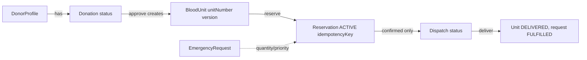

# LifeLink Domain Model

Date: 24 November 2026
Status: current-state working document for `feature/lifelink-bloodstream-experience`; historical Phase 2 records are preserved under [`../reviews/`](../reviews/).

**Authority:** enum literals, endpoints, and view fields follow [`API_CONTRACTS.md`](API_CONTRACTS.md). The transition tables below are taken from the entity classes in `project/backend/src/main/java/com/lifelink`, not from the superseded planned design. Mermaid views are in [`UML.md`](UML.md); class-to-concept evidence is in [`../academic/AOOP_CONCEPT_MAPPING.md`](../academic/AOOP_CONCEPT_MAPPING.md).

This replaces the earlier "planned domain design; no implementation claimed" version. The implementation is a JPA-annotated domain model inside a modular monolith: entities carry `@Entity`, extend `BaseEntity` (except `AuditEvent`), and expose guarded mutation methods. There are no typed identifier wrapper classes, no `RequestItem` aggregate, and no `BloodUnitFactory`.

---

## 1. Aggregate boundaries

| Aggregate root | Owned data | Consistency rule owned by the root |
| :--- | :--- | :--- |
| `Organization` | `OrganizationMembership` rows (via repository), verification, active flag, `StorageLocation` rows | Only a verified, active organization may supply stock; membership grants scoped permissions. |
| `User` (identity) | roles (`user_roles`), `RefreshToken`, `LoginAttempt` rows | Disabled/locked users cannot obtain or use tokens; token version and status are rechecked per request. |
| `DonorProfile` | `ConsentRecord`, `Appointment` | Consents and appointments are reached through the donor and scoped to owner or staff organization. |
| `Donation` | `ScreeningRecord` rows, optional `Appointment` link | Approval requires a stored passing screening and creates `BloodUnit` rows in the inventory aggregate. |
| `BloodUnit` | `activeReservationId`, location string, `InventoryMovement` rows, `@Version` | No release/reserve/dispatch outside its guarded methods; one active reservation per unit. |
| `EmergencyRequest` | `RequestEvent` rows, `quantity`, `priority`, timestamps | New requests start `PENDING_VERIFICATION`; verification precedes approval; fulfilment closes the request. |
| `Reservation` | expiry, `idempotencyKey`, unit/request/organization references | One active reservation per unit; cancel/expire clears the unit hold. |
| `Dispatch` | recipient, incident description, timestamps, `idempotencyKey` | At most one dispatch per reservation; only a `CONFIRMED` reservation may be dispatched. |
| `Notification` | read state, channel, delivery status | Only the owner may mark read; outbox delivery is fault-isolated per event. |
| `AuditEvent` | action, target, outcome, correlation id | Append-only in practice (the repository exposes save/query only); no retention or tamper-evidence. |

Cross-aggregate references use `Long` ids and JPA `ManyToOne` associations. For example `Reservation` holds `BloodUnit`, `EmergencyRequest`, and `Organization` entity references, plus a unique `idempotencyKey` column.

---

## 2. Entities

| Entity | Table / identity | Key fields | Notes |
| :--- | :--- | :--- | :--- |
| `BaseEntity` | mapped superclass | `id`, `publicId`, `createdAt`, `updatedAt`, `@Version version` | Abstract; all main aggregates except `AuditEvent` extend it. |
| `User` | `users`, `Long id` | `email`, `passwordHash`, `fullName`, `phone`, `Status`, `Set<Role>` | `UserView` exposes id, publicId, email, fullName, status, roles, permissions, memberships. |
| `OrganizationMembership` | membership table, `Long id` | `User`, `Organization`, `Role` | Source of `TenantAccessService` membership validation. |
| `Organization` | `organizations`, `Long id` | `name`, `Type`, `registrationCode`, `city`, `state`, `contactEmail`, `phone`, `verified`, `active`, `serviceArea` | Mirrors `OrganizationView`. |
| `DonorProfile` | donor profiles table, `Long id` | `userId`, `donorNumber`, `bloodGroup`, `dateOfBirth`, address/contact | Owned by a user or scoped staff. |
| `ConsentRecord` | consents table, `Long id` | `DonorProfile`, type, granted/revoked state | Withdrawal is an update on the record. |
| `Appointment` | `appointments`, `Long id` | `DonorProfile`, `Organization`, `scheduledAt`, `Status`, `notes` | Status transitions in §6.6. |
| `Donation` | `donations`, `Long id` | `DonorProfile`, `Organization`, optional `Appointment`, `donatedAt`, `Status`, `notes` | Screening evidence is a separate entity. |
| `ScreeningRecord` | `screening_records`, `Long id` | `Donation`, `passed`, `notes`, `screenedBy`, `screenedAt` | A passing record is required before approval. |
| `BloodUnit` | `blood_units`, `Long id` | `unitNumber`, `bloodGroup`, `componentType`, `Status`, `released`, `collectedAt`, `expiresAt`, `storageLocation` (String), `Organization`, optional `Donation`, `activeReservationId`, `version` | New units start `QUARANTINED`, `released=false`. |
| `InventoryMovement` | movements table, `Long id` | unit, delta, reason, location, timestamps | Appended on adjustments and lifecycle changes. |
| `StorageLocation` | `storage_locations`, `Long id` | `Organization`, `code`, `name`, `active` | Separate reference entity; `BloodUnit.storageLocation` is a free-text field. |
| `EmergencyRequest` | `emergency_requests`, `Long id` | `requestNumber`, `Organization`, `patientRef`, `bloodGroup`, `componentType`, `quantity`, `priority`, `requiredBy`, `Status`, `reason`, actor ids | No `RequestItem` child entity exists. |
| `RequestEvent` | request events table, `Long id` | request, action, detail, timestamps | Read through `GET /emergency-requests/{id}`. |
| `Reservation` | `reservations`, `Long id` | `BloodUnit`, `EmergencyRequest`, `Organization`, `Status`, `expiresAt`, `confirmedAt`, `idempotencyKey` | `idempotencyKey` is unique; V4 adds `active_unit_id` sparse slot. |
| `Dispatch` | `dispatches`, `Long id` | `Reservation` (unique), `EmergencyRequest`, `Organization`, `assignedStaff`, `Status`, `idempotencyKey`, `dispatchedAt`, `deliveredAt`, `recipientName`, `incidentDescription` | Created only from a `CONFIRMED` reservation. |
| `Notification` | `notifications`, `Long id` | `User`, `title`, `body`, `type`, `Channel`, `Status`, `readAt` | `Channel` = `IN_APP`/`EMAIL`/`SMS`; `Status` = `PENDING`/`SENT`/`FAILED`. |
| `OutboxEvent` | `outbox_events`, `Long id` | `eventId`, `topic`, `payload`, `Status`, `attempts`, `nextAttemptAt`, `lastError` | `Status` = `PENDING`/`PROCESSING`/`PROCESSED`/`FAILED`; retries up to 5 attempts. |
| `AuditEvent` | `audit_events`, `Long id` | `actorId`, `organizationId`, `action`, `targetType`, `targetId`, `correlationId`, `metadata`, `outcome`, `occurredAt` | Does not extend `BaseEntity`; string `outcome` (for example `SUCCESS`). |
| `IdempotencyRecord` | `idempotency_records`, `Long id` (V4) | `scope`, `key`, `request_hash`, `status`, `response_json`, `created_at`, `completed_at` | Unique `(scope, key)`; statuses `ACTIVE`/`COMPLETED`. |
| `RefreshToken`, `LoginAttempt` | identity tables, `Long id` | token hashes/family, IP, account, failure counts, lock timestamps | Used for rotation, replay detection, rate limiting, and lockout. |

---

## 3. Value types and enums

The implementation uses JDK types (`String`, `Instant`, `long`), shared enums in `com.lifelink.common`, and nested enums on entities. There are no custom typed-id value objects, `ExpiryWindow`, `BloodRequirement`, or `RejectionReason` classes.

| Enum | Literals |
| :--- | :--- |
| `Role` | `PLATFORM_ADMIN`, `BLOOD_BANK_ADMIN`, `INVENTORY_MANAGER`, `HOSPITAL_ADMIN`, `MEDICAL_STAFF`, `DONOR` |
| `Permission` | `USER_READ`, `USER_MANAGE`, `ORGANIZATION_READ`, `ORGANIZATION_MANAGE`, `DONOR_READ`, `DONOR_MANAGE`, `APPOINTMENT_MANAGE`, `DONATION_READ`, `DONATION_RECORD`, `SCREENING_REVIEW`, `DONATION_APPROVE`, `INVENTORY_READ`, `INVENTORY_WRITE`, `INVENTORY_RELEASE`, `REQUEST_READ`, `REQUEST_CREATE`, `REQUEST_APPROVE`, `ALLOCATION_REVIEW`, `ALLOCATION_CONFIRM`, `RESERVATION_READ`, `RESERVATION_CREATE`, `RESERVATION_CONFIRM`, `DISPATCH_READ`, `DISPATCH_CREATE`, `DISPATCH_MANAGE`, `NOTIFICATION_READ`, `AUDIT_READ`, `ANALYTICS_READ`, `PLATFORM_ADMIN` |
| `User.Status` | `ACTIVE`, `PENDING_VERIFICATION`, `LOCKED`, `DISABLED` |
| `Organization.Type` | `BLOOD_BANK`, `HOSPITAL` |
| `BloodGroup` | `A_POSITIVE`, `A_NEGATIVE`, `B_POSITIVE`, `B_NEGATIVE`, `AB_POSITIVE`, `AB_NEGATIVE`, `O_POSITIVE`, `O_NEGATIVE` |
| `ComponentType` | `WHOLE_BLOOD`, `RED_CELLS`, `PLASMA`, `PLATELETS`, `CRYOPRECIPITATE` |
| `BloodUnit.Status` | `COLLECTED`, `SCREENING`, `QUARANTINED`, `AVAILABLE`, `RESERVED`, `DISPATCHED`, `DELIVERED`, `EXPIRED`, `DISCARDED` |
| `Donation.Status` | `RECORDED`, `SCREENED`, `APPROVED`, `REJECTED` |
| `EmergencyRequest.Status` | `DRAFT`, `PENDING_VERIFICATION`, `VERIFIED`, `APPROVED`, `ALLOCATING`, `RESERVED`, `IN_TRANSIT`, `FULFILLED`, `REJECTED`, `CANCELLED`, `EXPIRED` |
| `EmergencyRequest.Priority` | `ROUTINE`, `URGENT`, `CRITICAL` |
| `Reservation.Status` | `ACTIVE`, `CONFIRMED`, `CANCELLED`, `EXPIRED` |
| `Dispatch.Status` | `PREPARING`, `IN_TRANSIT`, `DELIVERED`, `INCIDENT` |
| `Appointment.Status` | `REQUESTED`, `CONFIRMED`, `COMPLETED`, `CANCELLED`, `REJECTED` |
| `Notification.Channel` / `Notification.Status` | `IN_APP`, `EMAIL`, `SMS` / `PENDING`, `SENT`, `FAILED` |
| `OutboxEvent.Status` | `PENDING`, `PROCESSING`, `PROCESSED`, `FAILED` |

---

## 4. Invariants

| ID | Invariant | Enforced by |
| :--- | :--- | :--- |
| INV-01 | State changes go through guarded entity methods; illegal transitions throw `InvalidStateTransitionException` or `BusinessRuleViolationException` and surface as `409` from endpoints. | Entity methods + `GlobalExceptionHandler`. |
| INV-02 | `released == true` only after authorized release; `markExpired()` and `discard()` clear it. `deliver()` leaves it true. | `BloodUnit.release`, `markExpired`, `discard`, `deliver`. |
| INV-03 | `expiresAt > collectedAt` for units; donation time is not in the future; appointment and reservation expiry must be in the future. | Entity constructors. |
| INV-04 | At most one active reservation per unit. | V4 sparse unique index on `reservations.active_unit_id`, check constraints, `BloodUnit.reserve` guard, pessimistic unit lock. |
| INV-05 | A reservation may only claim a released, `AVAILABLE`, unexpired unit. | `BloodUnit.reserve(reservationId, now)` and service checks. |
| INV-06 | At most one dispatch per reservation; dispatch requires a `CONFIRMED` reservation. | Unique `reservation_id`, unique `idempotency_key`, `DispatchService`. |
| INV-07 | Reservation activation/cancellation/expiry clears the unit hold through `BloodUnit.clearReservation()`. | `ReservationService`, `InventoryService`, lifecycle scheduler. |
| INV-08 | Donation approval requires `SCREENED` status and a stored passing screening record. | `Donation.approve()` + `DonationService`. |
| INV-09 | Rejection requires an allowed source status; donation rejection cannot move `APPROVED`/`REJECTED` back. | `Donation.reject()` and `EmergencyRequest.reject()`. |
| INV-10 | Request verification (`PENDING_VERIFICATION → VERIFIED`) precedes approval (`VERIFIED → APPROVED`). | `EmergencyRequest.verify/approve`. |
| INV-11 | `X-Organization-Id` is validated against memberships and never bypasses permissions. | `TenantAccessService` + method security. |
| INV-12 | Audit `SUCCESS` rows are written in the state-change transaction; failures are recorded separately and do not fake success. | Service transactions + `AuditService`. |
| INV-13 | Idempotency keys are unique per scope; identical replay returns the stored response, divergent payload returns `409`. | V4 `idempotency_records`, `ReservationService.Idempotency`. |
| INV-14 | Every unit mutation increments `BaseEntity.version`; stale writes fail. | JPA `@Version` + pessimistic locks. |
| INV-15 | Notification read is owner-only; outbox processing is fault-isolated per item. | `NotificationService.markRead/processOutbox`. |
| INV-16 | Donor PII, credentials, tokens, and SQL are not exposed in errors or logs. | DTO mapping + `GlobalExceptionHandler` + logging policy. |
| INV-17 | Collections returned from role/permission accessors are immutable snapshots (`Set.copyOf`). | `Role.permissions()`, `User.effectivePermissions()`, `User.getRoles()`. |

Legacy planned invariants such as "domain classes have no Spring/JPA imports", "domain classes are final", "no public setters anywhere", "typed ids only", and "ArchUnit reflection test" are **not** implemented and must not be cited as current facts.

---

## 5. State machines

Legend: **API** = reachable from a documented v1 endpoint; **internal** = entity/service method with no dedicated endpoint. Illegal transitions produce `409` when reached through an endpoint.

### 5.1 Donation

```text
RECORDED --screen(true)--> SCREENED --approve()--> APPROVED
RECORDED --screen(false)--> REJECTED
RECORDED/ SCREENED --reject()--> REJECTED
```

| From | To | Trigger | Guard | Endpoint |
| :--- | :--- | :--- | :--- | :--- |
| `RECORDED` | `SCREENED` | `screen(true)` | `SCREENING_REVIEW` | `POST /donations/{id}/screen` |
| `RECORDED` | `REJECTED` | `screen(false)` or `reject()` | `SCREENING_REVIEW` / `DONATION_APPROVE` | `POST /donations/{id}/screen` or `/reject` |
| `SCREENED` | `APPROVED` | `approve()` | stored passing `ScreeningRecord`, `DONATION_APPROVE` | `POST /donations/{id}/approve` |
| `SCREENED` | `REJECTED` | `reject()` | `DONATION_APPROVE` | `POST /donations/{id}/reject` |

Approval creates `BloodUnit` rows in `QUARANTINED` with `released=false` and a `donationId` reference; `GET /donations/{id}/units` returns them.

### 5.2 EmergencyRequest

```text
PENDING_VERIFICATION --verify()--> VERIFIED --approve()--> APPROVED
APPROVED --markAllocating()--> ALLOCATING --markReserved()--> RESERVED
RESERVED --markInTransit()--> IN_TRANSIT --fulfil()--> FULFILLED
RESERVED --fulfil()--> FULFILLED
PENDING_VERIFICATION / VERIFIED / APPROVED --reject()--> REJECTED
PENDING_VERIFICATION / VERIFIED / APPROVED / ALLOCATING / RESERVED --cancel()--> CANCELLED
```

| From | To | Trigger | Guard | Endpoint |
| :--- | :--- | :--- | :--- | :--- |
| `PENDING_VERIFICATION` | `VERIFIED` | `verify(verifierId)` | `REQUEST_APPROVE` | `POST /emergency-requests/{id}/verify` |
| `VERIFIED` | `APPROVED` | `approve(approverId)` | `REQUEST_APPROVE` | `POST /emergency-requests/{id}/approve` |
| `PENDING_VERIFICATION`/`VERIFIED`/`APPROVED` | `REJECTED` | `reject()` | `REQUEST_APPROVE` | `POST /emergency-requests/{id}/reject` |
| `APPROVED` | `ALLOCATING` | `markAllocating()` | allocation confirmation | internal, via `AllocationService` |
| `ALLOCATING`/`RESERVED` | `RESERVED` | `markReserved()` | reservations created | internal |
| `RESERVED` | `IN_TRANSIT` | `markInTransit()` | dispatch departed | internal |
| `RESERVED`/`IN_TRANSIT` | `FULFILLED` | `fulfil()` | delivery | internal |
| listed statuses | `CANCELLED` | `cancel()` | `REQUEST_CREATE` or `REQUEST_APPROVE` in scope | `POST /emergency-requests/{id}/cancel` |
| any non-terminal | priority change | `changePriority(p, authorized)` | `REQUEST_APPROVE` | `PATCH /emergency-requests/{id}/priority` |

`DRAFT` and `EXPIRED` are persisted enum literals; new requests start at `PENDING_VERIFICATION`. Dispatch incidents use `Dispatch.Status.INCIDENT`, not a request status.

### 5.3 BloodUnit

```text
QUARANTINED / SCREENING / COLLECTED --release(now)--> AVAILABLE
COLLECTED / QUARANTINED --holdForScreening()--> SCREENING
AVAILABLE / SCREENING / COLLECTED --quarantine()--> QUARANTINED
AVAILABLE --reserve(reservationId, now)--> RESERVED
RESERVED --clearReservation()--> AVAILABLE or QUARANTINED
RESERVED --dispatch()--> DISPATCHED
DISPATCHED --deliver()--> DELIVERED
non-terminal --markExpired()--> EXPIRED
non-DISPATCHED/DELIVERED --discard(reason)--> DISCARDED
```

| From | To | Trigger | Guard | Endpoint |
| :--- | :--- | :--- | :--- | :--- |
| `QUARANTINED`/`SCREENING`/`COLLECTED` | `AVAILABLE` | `release(now)` | `INVENTORY_RELEASE`, not expired | `POST /inventory/{id}/release` |
| `COLLECTED`/`QUARANTINED` | `SCREENING` | `holdForScreening()` | internal | internal |
| `AVAILABLE`/`SCREENING`/`COLLECTED` | `QUARANTINED` | `quarantine()` | internal, clears `released` | internal |
| `AVAILABLE` | `RESERVED` | `reserve(reservationId, now)` | released, no active hold, not expired | `POST /reservations`, `POST /allocations/confirm` |
| `RESERVED` | `AVAILABLE`/`QUARANTINED` | `clearReservation()` | owning reservation cancel/expiry | `POST /reservations/{id}/cancel`, scheduler |
| `RESERVED` | `DISPATCHED` | `dispatch()` | reservation confirmed | `POST /dispatches/{id}/depart` |
| `DISPATCHED` | `DELIVERED` | `deliver()` | delivery confirmed | `POST /dispatches/{id}/deliver` |
| non-terminal | `EXPIRED` | `markExpired()` | expiry or staff action | `POST /inventory/{id}/expire`, scheduler |
| non-`DISPATCHED`/`DELIVERED` | `DISCARDED` | `discard(reason)` | nonblank reason | internal |

`DELIVERED`, `EXPIRED`, and `DISCARDED` are terminal. `changeLocation(location)` appends an `InventoryMovement` through `InventoryService` and does not change status.

### 5.4 Reservation

```text
ACTIVE --confirm(now)--> CONFIRMED
ACTIVE --cancel()--> CANCELLED
CONFIRMED --cancel()--> CANCELLED
ACTIVE --expire()--> EXPIRED
```

| From | To | Trigger | Guard | Endpoint |
| :--- | :--- | :--- | :--- | :--- |
| — | `ACTIVE` | constructor via `ReservationService.create` | unit `AVAILABLE`, `idempotencyKey`, expiry in future | `POST /reservations`, `POST /allocations/confirm` |
| `ACTIVE` | `CONFIRMED` | `confirm(now)` | not expired | `POST /reservations/{id}/confirm` |
| `ACTIVE`/`CONFIRMED` | `CANCELLED` | `cancel()` | scoped `RESERVATION_CREATE` | `POST /reservations/{id}/cancel` |
| `ACTIVE` | `EXPIRED` | `expire()` | TTL elapsed | internal scheduler |

There is no `PENDING` or `FULFILLED` reservation status. Leaving `ACTIVE` clears the unit hold.

### 5.5 Dispatch

```text
PREPARING --depart()--> IN_TRANSIT
IN_TRANSIT / INCIDENT --deliver(recipientName)--> DELIVERED
PREPARING / IN_TRANSIT / INCIDENT --reportIncident(description)--> INCIDENT
```

| From | To | Trigger | Guard | Endpoint |
| :--- | :--- | :--- | :--- | :--- |
| — | `PREPARING` | `DispatchService.create` | `CONFIRMED` reservation, blood-bank scope, idempotency key | `POST /dispatches` |
| `PREPARING` | `IN_TRANSIT` | `depart()` | `DISPATCH_MANAGE` | `POST /dispatches/{id}/depart` |
| `IN_TRANSIT`/`INCIDENT` | `DELIVERED` | `deliver(recipientName)` | nonblank recipient, `DISPATCH_MANAGE` | `POST /dispatches/{id}/deliver` |
| `PREPARING`/`IN_TRANSIT`/`INCIDENT` | `INCIDENT` | `reportIncident(description)` | nonblank description | `POST /dispatches/{id}/incident` |

A delivery after an incident is allowed (recovery delivery). Delivery moves the unit to `DELIVERED`, clears its active reservation pointer, and can fulfil the request.

### 5.6 Appointment

`REQUESTED → CONFIRMED → COMPLETED`; `REQUESTED → REJECTED`; `REQUESTED`/`CONFIRMED → CANCELLED`, via `PATCH /donors/appointments/{id}`.

---

## 6. Tenancy rules

| ID | Rule |
| :--- | :--- |
| T-01 | Organization-scoped rows carry an organization reference or id; services/repositories apply the predicate. |
| T-02 | `X-Organization-Id` is optional and validated against `OrganizationMembership` by `TenantAccessService`; result is cached per request. |
| T-03 | `PLATFORM_ADMIN` may select any organization and perform global user/audit reads; it does not bypass state machines. |
| T-04 | A donor sees only their own profile, consents, and appointments; staff need `DONOR_READ` and tenant scope. |
| T-05 | Blood units remain owned by the collecting bank while reserved for a hospital. |
| T-06 | A reservation references the requesting request and the supplying organization; dispatch is authorized in the supplying bank. |
| T-07 | Cross-organization allocation requires `ALLOCATION_REVIEW` for suggestions and `ALLOCATION_CONFIRM` for confirmation. |
| T-08 | Notifications are per user; audit queries require explicit organization id for non-platform users with multiple memberships. |
| T-09 | Analytics aggregate only rows visible to the caller's role and organization. |
| T-10 | UI role checks are cosmetic; server authorization is authoritative. |

---

## 7. Traceability chain



1. `Donation.approve()` creates units with `donationId`; `GET /donations/{id}/units` returns them.
2. Each `BloodUnit` has `unitNumber`, `publicId`, `version`, `activeReservationId`, and a location string; movements are appended. `activeReservationId` is internal entity/repository state used to hold one active reservation per unit; `InventoryDtos.View` does not expose it.
3. Each `Reservation` stores its unit, request, organization, expiry, and idempotency key; V4 records the request fingerprint separately.
4. Each `Dispatch` stores reservation, request, organization, staff, and idempotency key; delivery closes the chain and produces audit/outbox entries with one correlation id.
5. No step may be skipped: reservation requires `AVAILABLE` unit, dispatch requires `CONFIRMED` reservation, fulfilment follows delivery.
