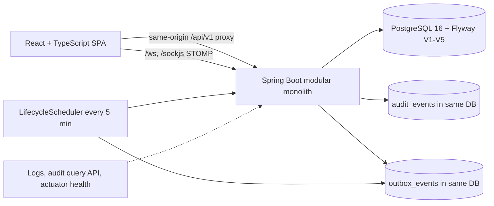
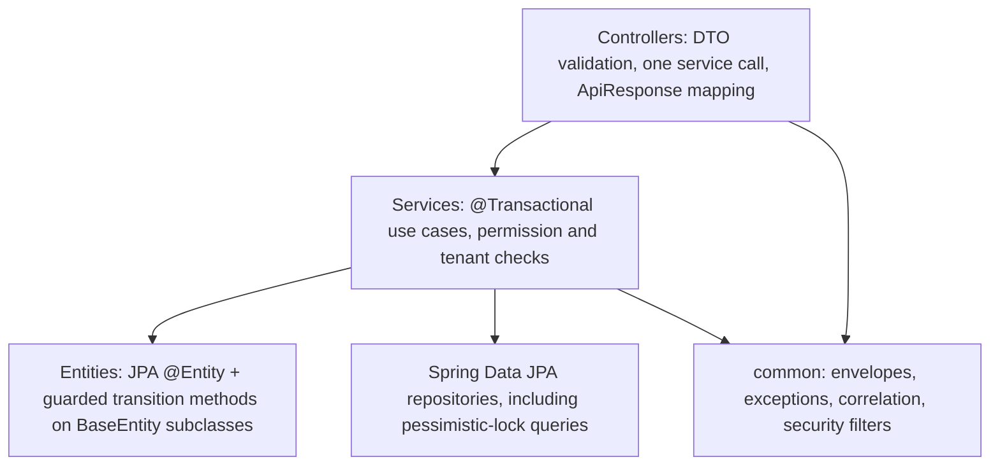

# LifeLink System Architecture

Date: 24 November 2026
Status: current-state working document for `feature/lifelink-bloodstream-experience` (base HEAD `59401d45e511183ede59e7d55073f07e2cf5eacd`, changes uncommitted, nothing pushed). Historical Phase 2 records remain under [`../reviews/`](../reviews/) and are not rewritten. The authoritative reconciliation is [`../reviews/CURRENT_STATE_ENGINEERING_AND_DESIGN_AUDIT.md`](../reviews/CURRENT_STATE_ENGINEERING_AND_DESIGN_AUDIT.md).
**Source of truth for external behaviour:** [`API_CONTRACTS.md`](API_CONTRACTS.md). Companion documents: [`DOMAIN_MODEL.md`](DOMAIN_MODEL.md), [`UML.md`](UML.md), [`../academic/AOOP_CONCEPT_MAPPING.md`](../academic/AOOP_CONCEPT_MAPPING.md).

This document replaces the earlier "planned design / no implementation claimed" version.
It describes the code and configuration now in `project/`, specifically Spring Boot
`3.5.16` with Java 21 bytecode target, Maven Wrapper `3.9.11`, Flyway `V1`–`V5`, and the
React/TypeScript SPA. `V5` adds `users.token_version` for persistent, monotonic access-token
revocation. Nothing here is a production-readiness claim; this is a local-development /
supervised-demo architecture.

---

## 1. Architectural style and context

LifeLink is a **modular monolith**: one Spring Boot deployable, one PostgreSQL database
(H2 in PostgreSQL compatibility mode for fast tests), and business modules separated by
Java package. Modules call each other through Spring service beans, not network calls.
The SPA is served by an nginx-based container that reverse-proxies `/api/`, `/ws/`, and
`/sockjs/` to the backend.



The API is the integration surface. Successful single responses use `ApiResponse<T>`,
paged lists use `PageResponse<T>`, and errors use the structured `ErrorResponse` with
`correlationId`. Some list endpoints return plain arrays inside `ApiResponse`; the exact
set is listed in `API_CONTRACTS.md`.

---

## 2. Module map

Packages are flat under `com.lifelink.<module>`: controller, service, repository, entity,
DTO, and configuration classes live together rather than in `api`/`application`/`domain`/
`infrastructure` sub-layers. Persistence annotations are on the entities themselves.

| Package | Responsibility | Key classes | Contract surface |
| :--- | :--- | :--- | :--- |
| `common` | Envelopes, correlation, exceptions, seeding, lifecycle jobs, shared enums | `ApiResponse`, `PageResponse`, `CorrelationIdFilter`, `GlobalExceptionHandler`, `DevelopmentDataSeeder`, `LifecycleScheduler`, `BloodGroup`, `ComponentType`, `BaseEntity` | cross-cutting |
| `identity` | Auth, JWT, users, roles/permissions, memberships, tenant selection, rate limiting | `AuthService`, `JwtService`, `SecurityConfig`, `TenantAccessService`, `UserService`, `LoginAttempt` | `/auth/*`, `/users*` |
| `organization` | Organization profiles, verification, memberships | `OrganizationService`, `Organization`, `OrganizationController` | `/organizations*` |
| `donor` | Donor profiles, consents, appointments, donations and screening | `DonorService`, `DonationService`, `ScreeningRecord`, `Appointment` | `/donors*`, `/donations*` |
| `inventory` | Blood unit lifecycle, movements, alerts, stock queries | `InventoryService`, `BloodUnit`, `InventoryMovement`, `StorageLocation` | `/inventory*` |
| `emergency` | Emergency requests and request events | `EmergencyRequestService`, `EmergencyRequest`, `RequestEvent` | `/emergency-requests*` |
| `allocation` | Advisory candidate scoring and confirmation orchestration | `AllocationService`, `FeefoStrategy`, `StrictSameGroupSpecification`, `CompatibilitySpecification`, `AllocationCandidate` | `/allocations/*` |
| `reservation` | Reservation lifecycle, unit holds, idempotency claims | `ReservationService`, `Reservation`, `ReservationService.Idempotency` | `/reservations*` |
| `dispatch` | Dispatch lifecycle from confirmed reservation | `DispatchService`, `Dispatch` | `/dispatches*` |
| `notification` | Inbox, STOMP config, outbox processing, channels | `NotificationService`, `OutboxEvent`, `StompAuthenticationInterceptor`, `WebSocketConfig` | `/notifications*`, `/ws` |
| `audit` | Actor/action/outcome log and queries | `AuditService`, `AuditEvent` | `/audit-logs` |
| `analytics` | Read-only scoped metrics | `AnalyticsService`, `AnalyticsController` | `/analytics/*` |

Cross-aggregate references use numeric `Long` identifiers and JPA associations; there are
no typed identifier wrapper classes (for example no `UnitId` or `OrganizationId` type).
Where a `BloodUnit` belongs to an organization, the entity holds a `ManyToOne` to
`Organization` and the service checks organization scope.

---

## 3. Layer boundaries (as implemented)



Implemented conventions:

1. Controllers validate `@Valid` DTOs and call one application service method. They do not
   mutate entities directly.
2. Services are the `@Transactional` boundary and the authorization boundary; they call
   `TenantAccessService` for organization-scoped resources.
3. Entities extend `BaseEntity` (`id`, `publicId`, `createdAt`, `updatedAt`, `@Version`) and
   expose guarded methods such as `reserve()`, `markDispatched()`, `verify()`, `approve()`.
   They do carry JPA annotations; the planned "domain with no Spring/JPA imports" rule was
   not adopted.
4. Cross-module calls go through the owning module's service bean (for example
   `AllocationService` calls `ReservationService.Idempotency`). There is no separate
   published interface per module beyond the concrete services and the strategy/specification
   interfaces in `allocation` and `notification`.
5. The SPA may hide controls by role, but every endpoint rechecks permission and
   organization scope server-side.

A Future conformance checklist remains aspirational rather than a claim: uniform
module-level architecture tests (ArchUnit) are not present, and the checks in
`quality/TEST_STRATEGY.md` are source-review and runtime tests, not package-boundary tests.

---

## 4. Transaction strategy

| Use case | Boundary | Lock / protection | Notes |
| :--- | :--- | :--- | :--- |
| Donation approval | `DonationService.approve` | Version on `Donation` | Creates quarantined units and writes audit in the same transaction. |
| Unit release | `InventoryService.release` | `BloodUnitRepository.findByIdForUpdate` (`PESSIMISTIC_WRITE`) | Rechecks status/expiry under lock; appends movement. |
| Allocation confirmation | `AllocationService.confirm` | Idempotency claim + pessimistic locks sorted by unit id | All-or-nothing reservations; request moves `APPROVED`/`ALLOCATING` → `RESERVED`. |
| Reservation create/confirm/cancel | `ReservationService` | Pessimistic lock on `BloodUnit`, `@Version` backstop | Cancel releases the unit only for the owning reservation. |
| Dispatch create/depart/deliver | `DispatchService` | Pessimistic lock on unit, unique dispatch per reservation, `@Version` backstop | Dispatch creation is blood-bank-only in the supplying organization. |
| Suggestions | `AllocationService.suggest` | Snapshot read | Advisory only; no writes or locks. |
| Audit/analytics reads | service read transactions | Tenant predicates | Analytics aggregates only caller-visible data. |

Rules:

- Service methods own the transaction; domain objects are not transaction-aware.
- Audit `SUCCESS` rows are written inside the business transaction. Failed business work
  does not leave a misleading success audit row.
- Lock-acquisition failures, query timeouts, optimistic-lock failures, and
  `DataIntegrityViolationException` map centrally to `409 CONCURRENCY_CONFLICT`.
- Business rule/state violations map to `409` with their own codes; validation failures
  map to `400`; unexpected failures to `500`. `GlobalExceptionHandler` is the single
  mapper and never exposes stack traces, SQL, tokens, or credentials.
- No notification email/SMS is sent on the request thread. In-app notifications and
  outbox rows are written in the same transaction as the triggering state change.

---

## 5. Concurrency strategy

1. **Contended writes:** `BloodUnit` is the hotspot. `BloodUnitRepository.findByIdForUpdate`
   issues a pessimistic write lock before status checks in reservation, allocation,
   dispatch, and release paths.
2. **Optimistic backstop:** `BaseEntity.version` is a JPA `@Version` column incremented on
   mutation.
3. **Database constraints (V4) and token version (V5):** `idempotency_records(scope, key)`
   is unique; a sparse unique index plus check constraints allow only one `ACTIVE` reservation
   per unit; unit and reservation status CHECK constraints reject impossible states. `V5`
   adds `users.token_version`, incremented on every credential/status transition so old
   access tokens stay revoked after lock, disable, and re-enable.
4. **Deterministic lock order:** allocation confirmation locks selected units in ascending
   id order to reduce deadlock risk.
5. **Advisory path:** `POST /allocations/suggestions` takes no lock and changes no state.
6. **No distributed lock:** correctness is local to one database. The auth rate limiter and
   the logout `jti` denylist (`F-04`) are in-memory and therefore only correct for a single
   backend instance; a multi-instance deployment needs shared stores for both. Persistent
   `token_version` revocation is database-backed and does not have that limitation.

See [`ADR/ADR-003-inventory-concurrency.md`](ADR/ADR-003-inventory-concurrency.md).

---

## 6. Event and outbox strategy (as implemented)

The planned generic outbox-for-all-domain-events design was narrowed: the implemented
`outbox_events` table carries `notification.created` events written by
`NotificationService.notifyUser` alongside the `Notification` row. `OutboxEvent` has
`PENDING`, `PROCESSING`, `PROCESSED`, `FAILED`, an `eventId`, attempts, `nextAttemptAt`, and
`lastError`. `InAppNotificationChannel` publishes in-app delivery;
`UnconfiguredProviderChannel` represents unconfigured external channels.

```mermaid
sequenceDiagram
    participant S as Application service
    participant DB as Database (same transaction)
    participant L as LifecycleScheduler (5 min)
    participant N as NotificationService.processOutbox
    S->>DB: update aggregate + version
    S->>DB: insert audit_event (SUCCESS) into audit_events
    S->>DB: insert notification + outbox_event(notification.created)
    DB-->>S: commit
    L->>N: processOutbox()
    N->>DB: findDue(now)
    N->>N: dispatch to channel; per-item try/catch
    N->>DB: markProcessed() or markFailed(error, retryAt)
```

- Delivery is at-least-once; notification rows are keyed by `publicId` and outbox events
  by `eventId`. Processing is fault-isolated per item: one bad event cannot stop the batch.
- Failed events retry with backoff and end in `FAILED` after 5 attempts; `lastError` is
  truncated before storage.
- Live WebSocket push from the STOMP broker is configured and unit-tested at the
  interceptor level. A standalone Node smoke test through the Compose nginx proxy recorded
  an authenticated `CONNECTED`, a personal-queue `SUBSCRIBE`, and a delivered `MESSAGE`
  ([`../evidence/STOMP_SMOKE_RESULT.json`](../evidence/STOMP_SMOKE_RESULT.json)).
- The SPA now mounts `useRealtimeNotifications`, dynamically loads SockJS and STOMP.js,
  connects through `/ws` with a bearer JWT, and invalidates React Query notification
  caches on broker events. Browser capture confirms CONNECT with bearer token,
  SUBSCRIBE to `/user/queue/notifications`, and a CONNECTED frame
  ([`../evidence/BROWSER_STOMP_RESULT.json`](../evidence/BROWSER_STOMP_RESULT.json)).
  REST `/notifications` remains authoritative; polling is the fallback when no socket can
  connect. The standalone capture recorded zero REST polls during that focused observation,
  while the Playwright suite separately asserts polling requests exist.
- No email/SMS provider is configured or claimed.

See [`ADR/ADR-004-outbox-notifications.md`](ADR/ADR-004-outbox-notifications.md).

---

## 7. Observability

- **Correlation:** `CorrelationIdFilter` accepts an inbound `X-Correlation-Id` or generates
  one, stores it in MDC, and includes it in `ApiResponse`, error bodies, and audit rows.
- **Logging:** lifecycle jobs log counts; unexpected failures are logged centrally. Do not
  assume structured JSON logging in deployed profiles — that was a design intent, not a
  verified configuration in this phase.
- **Health:** `application.yml` exposes actuator `health,info,metrics,prometheus`. The final
  Compose probe on `18080/15173/15432` recorded healthy services, backend
  `/actuator/health` HTTP 200 with `liveness`/`readiness` groups, frontend `/healthz` HTTP
  200 `ok`, SPA root HTTP 200, and login through the nginx proxy HTTP 200; Flyway V1–V5 all
  succeeded and seeding produced organizations=2, users=6, blood_units=9
  ([`../evidence/COMPOSE_VERIFICATION.json`](../evidence/COMPOSE_VERIFICATION.json)).
- **Audit:** queryable through `/api/v1/audit-logs` with organization, actor, action,
  time-range, and outcome filters. It is not a replacement for technical logs and has no
  retention or tamper-evidence mechanism.
- **Metrics:** actuator endpoints are configured; no dashboard, SLO, or alerting is claimed.

---

## 8. Security architecture

1. **Authentication:** `POST /auth/login` checks a BCrypt hash and issues a short-lived
   JWT access token plus a rotating refresh token. Refresh-token reuse revokes the family.
   Access tokens carry `jti` and `token_version`. Password change and any status transition
   increment the persistent `V5` token version, permanently revoking older access tokens.
   `POST /auth/logout` revokes the presented refresh token and denies only the presented
   bearer `jti` in the process that handled it (`F-04`, process-local in-memory denylist).
2. **JWT secret:** `JWT_SECRET` is required in every non-test profile; there is no committed
   fallback. Missing, short (<32 byte), or test-only secrets fail fast at startup. The test
   profile has a dedicated test-only key.
3. **Authorization:** `Role` and `Permission` enums drive programmatic checks in services
   and controllers; no `@PreAuthorize` or `@RolesAllowed` annotations are used. Notable rule:
   dispatch creation requires `DISPATCH_CREATE` in the **supplying** blood-bank organization;
   hospital membership alone never grants it.
4. **Tenancy:** `X-Organization-Id` is optional and validated by `TenantAccessService`
   against memberships (platform admins may select any id). It narrows scope and never
   bypasses permissions. Invalid ids are `400` (malformed) or `403` (non-member). The SPA
   sends the header and clears React Query caches on organization switch. All three
   `/api/v1/analytics/*` endpoints use the same validated scope (`F-02`): platform admins
   may omit the header for a global view or send it to scope one organization; non-admins
   with one membership are implicitly scoped, while multiple memberships require an explicit
   selection. `AnalyticsPage` exposes an Organization scope select and includes the scope in
   query keys; selecting **All organizations** passes explicit `null` so the SPA omits
   `X-Organization-Id` instead of sending a literal null value. Other protected pages
   do not fall back to a first membership when none is selected.
5. **Rate limiting and lockout:** login/register/refresh 401 responses are limited to
   10/60s per IP+account+path in memory; the next attempt returns `429 RATE_LIMITED`. Failed
   logins also persist 5-failure/15-minute account lockout in `login_attempts`. The limiter
   and the logout `jti` denylist do not persist or coordinate across multiple backend
   instances. No MFA or breach-password check is implemented.
6. **Transport:** CORS allows origins from `CORS_ALLOWED_ORIGINS` (default
   `http://localhost:5173`), methods `GET,POST,PATCH,PUT,DELETE,OPTIONS`, headers
   `Authorization,Content-Type,X-Correlation-Id,Idempotency-Key,X-Organization-Id`,
   exposes `X-Correlation-Id`, and disallows credentials. TLS/HTTPS termination is not
   configured in the local Compose stack.
7. **WebSocket:** STOMP CONNECT requires a `Bearer`-prefixed JWT (native `Authorization`
   preferred, STOMP header/passcode/login fallback; no raw token); SUBSCRIBE is restricted
   to the caller's own queue and requires `NOTIFICATION_READ`; SEND is denied because no
   `@MessageMapping` handlers exist. Broker errors are generic. Both a standalone Node
   client and the authenticated SPA bridge were observed through the nginx proxy. Vite
   strips `Origin` from `/ws` proxy requests; the socket client is never opened for
   anonymous visitors.
8. **UI security posture:** SPA role checks only shape the interface; server authorization
   is authoritative.

See [`ADR/ADR-002-auth-and-tenancy.md`](ADR/ADR-002-auth-and-tenancy.md).

---

## 9. Deployment view

```mermaid
flowchart LR
    Browser[Browser on host] --> NG[Nginx in frontend container :8080]
    NG -->|/api/v1 reverse proxy| BE[Spring Boot backend container :8080]
    NG -->|/ws and /sockjs| BE
    BE --> DB[(PostgreSQL 16 container)]
    BE --> ACT[/actuator/health]
    DEV[Developer shell: docker compose with JWT_SECRET] --> NG
```

- **Local development:** backend via `./mvnw spring-boot:run` with H2 (PostgreSQL mode)
  and `SEED_DEMO_DATA=true`; frontend via `npm run dev` with Vite proxying `/api`.
- **Docker Compose:** images `lifelink/backend:dev` and `lifelink/frontend:dev` were built
  successfully. Compose binds db/backend/frontend to `127.0.0.1` with overridable
  `POSTGRES_PORT`, `BACKEND_PORT`, and `FRONTEND_PORT`; the verified environment uses
  `15432`, `18080`, and `15173` because port `8080` is occupied locally. Startup requires
  `JWT_SECRET` supplied externally in the shell (never persisted or printed);
  `CORS_ALLOWED_ORIGINS` derives from `FRONTEND_PORT`. The Compose demo sets
  `SEED_DEMO_DATA=true`; standalone PostgreSQL defaults to no demo seed. See
  [`../deployment/DEPLOYMENT_GUIDE.md`](../deployment/DEPLOYMENT_GUIDE.md).
- **Flyway migrations:** `V1__core_schema.sql`, `V2__operational_schema.sql`,
  `V3__dispatch_idempotency.sql`, `V4__integrity_and_idempotency.sql`, and
  `V5__persistent_token_version.sql` run at startup; all five succeeded in the final
  Compose verification.
- **Profiles:** `default`/`dev`/`postgres` seed according to `lifelink.seed.enabled`;
  `application-postgres.yml` defaults `SEED_DEMO_DATA` to `false`, `application.yml` to
  `true`. No `prod` deployment is claimed.
- **CI:** root `.github/workflows` is intentionally not installed in this repository;
  `project/deployment/github-actions.yml` is a template only. CI execution is not claimed.

See [`ADR/ADR-001-modular-monolith.md`](ADR/ADR-001-modular-monolith.md) and
[`ADR/ADR-005-local-dev-database.md`](ADR/ADR-005-local-dev-database.md).

---

## 10. Conformance checklist for implementers

- [x] Controller methods validate DTOs and delegate to one service method.
- [x] State changes use guarded entity methods and `BaseEntity.version`.
- [x] Protected endpoints check permissions; organization-scoped ones validate
      `X-Organization-Id` through `TenantAccessService`.
- [x] Audit `SUCCESS` rows and notification/outbox rows are written in the state-change transaction.
- [x] Allocation confirmation, reservation creation, and dispatch creation honour idempotency,
      including the 120-character key limit (`F-05`).
- [x] All analytics endpoints validate organization scope (`F-02`).
- [x] Documents use the enum literals and paths from `API_CONTRACTS.md`.
- [ ] Automated ArchUnit-style package-boundary tests (not present; source review only).
- [ ] CI pipeline execution (not installed in this repository; documented as a deployment step
      only — no GitHub Actions run is claimed).
- [x] Full-stack login / health evidence, standalone SockJS/STOMP smoke evidence, and
      authenticated browser STOMP frame evidence recorded.
- [ ] Shared revocation/rate-limit store for multi-instance deployment (process-local today).
