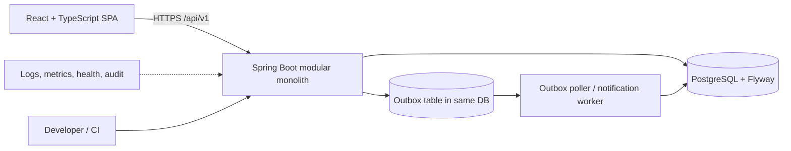
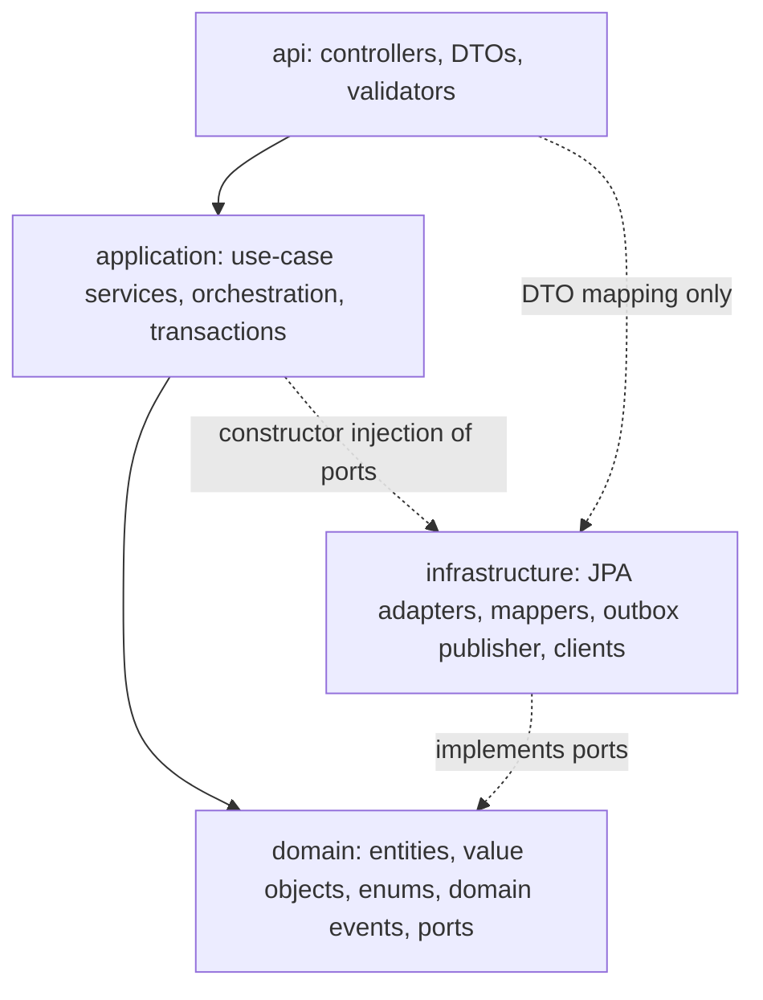
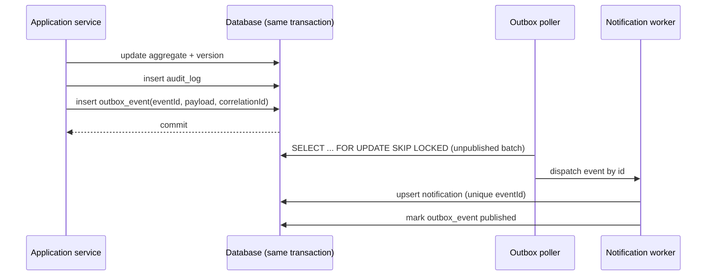
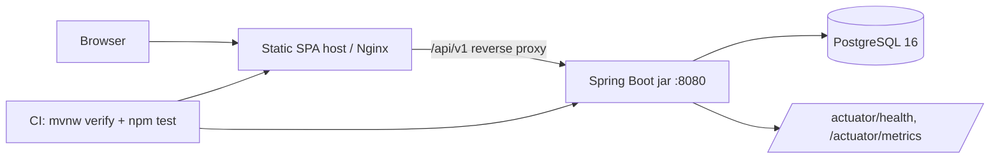

# LifeLink System Architecture

**Status:** Planned design (no implementation claimed).  
**Source of truth for external behaviour:** [`API_CONTRACTS.md`](API_CONTRACTS.md). Companion documents: [`DOMAIN_MODEL.md`](DOMAIN_MODEL.md), [`UML.md`](UML.md), `../academic/AOOP_CONCEPT_MAPPING.md`.  
**Baseline:** The initial audit recorded a documentation-only repository; everything described here is greenfield.

---

## 1. Architectural style and context

LifeLink is a **modular monolith**: one Spring Boot deployable, one PostgreSQL database, twelve business modules with explicit package boundaries. Modules communicate through application interfaces and domain events, not through network calls. This keeps transaction boundaries simple and makes the object-oriented boundaries visible for assessment.

The API is the only integration surface. All list responses use `PageResponse<T>`, all single responses use `ApiResponse<T>`, and errors use `ApiError` with `correlationId`.

## 2. Module map

| Module | Responsibility | Depends on | Contract surface |
| :--- | :--- | :--- | :--- |
| identity | Authentication, token rotation, users, roles/permissions, tenant context | shared, organization (membership lookup) | `/auth/*`, `/users*` |
| organization | Organization profiles, verification, memberships | shared | `/organizations*` |
| donor | Donor profiles, consents, appointments | shared, organization | `/donors*` |
| donation | Donation records, screening, approval/rejection, unit creation trigger | shared, donor, inventory (unit factory port) | `/donations*` |
| inventory | Blood unit lifecycle, movements, alerts, stock queries | shared, organization | `/inventory*` |
| emergency | Emergency requests, items, approval/rejection/cancellation | shared, organization | `/emergency-requests*` |
| allocation | Advisory candidate evaluation and confirmation orchestration | shared, inventory, emergency, reservation | `/allocations/*` |
| reservation | Reservation lifecycle and unit hold/release | shared, inventory | `/reservations*` |
| dispatch | Dispatch lifecycle from confirmed reservation | shared, reservation, inventory | `/dispatches*` |
| notification | User inbox, unread count, mark read, event-to-notification mapping | shared | `/notifications*` |
| audit | Append-only actor/action/outcome log and queries | shared | `/audit-logs` |
| analytics | Read-only role/organization-scoped metrics | shared, read models over inventory/emergency | `/analytics/*` |

`shared` is a small kernel: envelope types, correlation handling, exception types, `TenantContext`, ports (`OutboxPort`, `AuditPort`, `IdempotencyPort`), and cross-cutting configuration. It contains no business rules.

## 3. Layer boundaries

Each module has the same four-layer shape under `com.lifelink.<module>`:

### 3.1 Allowed dependencies

| From | May depend on | Must not depend on |
| :--- | :--- | :--- |
| api | application of its own module, shared envelope/DTO types | domain entities directly, JPA, repositories |
| application | domain of its own module, published application interfaces of other modules, shared ports | controllers, JPA annotations, HTTP types |
| domain | only JDK types and shared kernel value types | Spring, JPA, Jackson, controllers, infrastructure |
| infrastructure | domain ports and entities, Spring Data JPA, database drivers | controllers, other modules' private implementation classes |

### 3.2 Boundary rules

1. Controllers validate the DTO, call one application service method, and map the result. They never mutate domain state.
2. Domain entities expose intention-revealing methods (`release()`, `reserve(...)`, `cancel(...)`) and no public setters. Continuous state is held in enums and value objects.
3. Cross-module calls go through an application interface published by the owning module (for example `ReservationCommands` used by allocation). Direct repository access across modules is forbidden.
4. Cross-module data is referenced by typed identifier (`OrganizationId`, `DonationId`, `UnitId`), not by a foreign JPA entity graph.
5. The frontend may hide buttons based on roles; the server rechecks permissions and organization scope on every request.
6. A module's package is allowed to import `com.lifelink.shared.*` but not another module's `api` or `infrastructure` packages.

## 4. Transaction strategy

| Use case | Boundary | Lock / protection | Notes |
| :--- | :--- | :--- | :--- |
| Donation approval | Single transaction in `DonationService.approve` | Version on `Donation`; unit inserts | Creates units, writes audit and outbox rows in the same transaction. |
| Unit release | Single transaction in `InventoryService.release` | `PESSIMISTIC_WRITE` on the unit row | Rechecks status and expiry under lock; writes movement + outbox. |
| Allocation confirmation | Single transaction in `AllocationService.confirm` | Pessimistic lock per selected unit, ordered by unit id | Idempotency record inserted first; all-or-nothing reservations. |
| Reservation create/confirm/cancel | Single transaction in `ReservationService` | Lock on unit; optimistic `@Version` as backstop | Cancel returns unit to `AVAILABLE` only for the owning reservation. |
| Dispatch create/depart/deliver | Single transaction in `DispatchService` | Unique dispatch per reservation; version on unit | Delivery cascades to reservation/request completion through application events handled after commit or in the same orchestration transaction. |
| Suggestions | Read-only transaction | None | Never writes; advisory only. |
| Analytics / audit reads | Read-only transaction | None | Read models scoped by tenant before aggregation. |

Rules:

- Application service methods are the `@Transactional` boundary; domain objects are not transaction-aware.
- Outbox, audit, and idempotency writes participate in the same transaction as the state change (see §6).
- Idempotency keys are stored with a unique constraint on `(scope, idempotencyKey)`. A replay returns the stored response; it does not repeat domain mutations.
- Business conflicts map to 409; validation failures to 400; unexpected failures to 500 through one `GlobalExceptionHandler`.
- Transactions stay short: no network calls, template rendering, or notification dispatch inside them.

## 5. Concurrency strategy

1. **Contended writes:** `BloodUnit` is the concurrency hotspot. `BloodUnitRepository.lockByIdForUpdate(UnitId)` issues `SELECT ... FOR UPDATE` before checking status. The second caller waits, then sees `RESERVED` and receives 409.
2. **Optimistic backstop:** `BloodUnit.version` is incremented on every mutation with `@Version`; a stale write fails fast and is retried once for transient lock/version failures at the application boundary.
3. **Database constraints:** a partial unique index allows only one active (`PENDING`/`CONFIRMED`) reservation per unit, and a unique index allows only one dispatch per reservation. Check constraints reject impossible dates and statuses.
4. **Deterministic lock order:** allocation confirmation locks units sorted by id to avoid deadlocks between concurrent confirmations.
5. **No distributed locks:** a single database and one deployable mean no Redis lock is needed for correctness.
6. **Advisory path:** `POST /allocations/suggestions` uses a snapshot query and never claims units, so no lock is taken.

See [`ADR/ADR-003-inventory-concurrency.md`](ADR/ADR-003-inventory-concurrency.md).

## 6. Event and outbox strategy

Domain methods append events to the aggregate (`DonationApproved`, `BloodUnitReleased`, `ReservationCreated`, `ReservationConfirmed`, `ReservationCancelled`, `DispatchDeparted`, `DispatchDelivered`, `EmergencyRequestApproved`). The application service drains them and writes `outbox_event` rows in the **same** transaction as the state change.

- Delivery is **at-least-once**; consumers are idempotent on `eventId` (unique constraint on notification).
- Ordering is guaranteed per aggregate id, not globally; the UI does not rely on global ordering.
- A failed consumer leaves the row unpublished with a retry count; repeated failure is visible in metrics and logs.
- No notification email/SMS is sent from the request thread; out-of-scope external channels would be adapters behind the same worker.

See [`ADR/ADR-004-outbox-notifications.md`](ADR/ADR-004-outbox-notifications.md).

## 7. Observability

- **Correlation:** `CorrelationIdFilter` accepts an inbound correlation id or generates one, stores it in MDC, and includes it in `ApiResponse`/`ApiError`, audit rows, outbox rows, and log lines.
- **Logging:** structured JSON in deployed profiles, readable console locally. INFO for state transitions, WARN for rejected idempotent replays and retryable conflicts, ERROR for unexpected failures. Passwords, tokens, phone numbers, and full donor details are never logged.
- **Metrics:** HTTP request count/latency/status by endpoint and role, outbox lag and retry count, reservation conflicts, expiring-unit scan duration.
- **Health:** liveness and readiness probes; readiness includes database connectivity, not external notification providers.
- **Audit separation:** business audit is a queryable, append-only table (`/audit-logs`); it is not a replacement for technical logs.
- **Error clarity:** `GlobalExceptionHandler` maps domain exceptions to the documented codes without exposing stack traces, SQL, or credentials.

## 8. Security architecture

1. **Authentication:** `POST /auth/login` validates a BCrypt hash and issues a short-lived JWT access token plus a rotating refresh token. `POST /auth/refresh` rotates the refresh token; reuse of an old token is rejected. `POST /auth/logout` revokes the presented refresh token.
2. **Authorization:** permissions named exactly as in the contract (for example `USER_READ`, `INVENTORY_RELEASE`, `REQUEST_APPROVE`, `ALLOCATION_CONFIRM`, `AUDIT_READ`, `ANALYTICS_READ`) are enforced by method security in application services and rechecked where needed in domain commands. Roles are coarse groups of permissions.
3. **Tenancy:** `TenantContext` is populated from the validated token's active membership. Repository queries add the organization predicate; service methods compare resource `organizationId` with the caller's scope. A caller with several memberships must select the active organization. `PLATFORM_ADMIN` is the only role allowed explicit cross-organization reads.
4. **Cross-organization workflow:** a hospital request may target blood units owned by a verified bank organization. This is the single sanctioned exception: it requires `ALLOCATION_REVIEW`/`ALLOCATION_CONFIRM`, records both `requestingOrganizationId` and `supplyingOrganizationId` on the reservation, and is audited.
5. **Transport and input:** HTTPS in deployed profiles, strict CORS allowlist, request size limits, validation on all DTOs, parameterized queries, rate limiting on auth endpoints (429).
6. **Data protection:** passwords hashed with BCrypt; tokens only in the intended auth responses; no secrets in source control; demo accounts enabled exclusively by the local development profile.
7. **UI security posture:** SPA role checks only shape the interface. Every action is authorized again by the API.

See [`ADR/ADR-002-auth-and-tenancy.md`](ADR/ADR-002-auth-and-tenancy.md).

## 9. Deployment view

- **Local development:** Maven Wrapper (Java 21 bytecode target), Node/Vite dev server proxying `/api/v1`, optional Docker Compose PostgreSQL. Fast tests use H2 in PostgreSQL mode and require no Docker. Redis is not used; inventory consistency relies on database locks and persisted idempotency keys.
- **Build:** one executable jar; frontend produces static assets; Flyway migrations run at startup before application traffic.
- **Configuration:** environment variables for datasource, JWT signing key, CORS origins, and profile selection; no secrets committed.
- **Deployed profiles:** `local`, `test`, `prod` (prod is a target, not a claimed deployment). Health probes gate traffic; logs and metrics are collected by the hosting environment.
- **Scaling model:** scale vertically first; the design does not require session affinity because authentication is stateless.

See [`ADR/ADR-001-modular-monolith.md`](ADR/ADR-001-modular-monolith.md) and [`ADR/ADR-005-local-dev-database.md`](ADR/ADR-005-local-dev-database.md).

## 10. Conformance checklist for implementers

- [ ] No controller mutates a domain object directly.
- [ ] No domain class imports Spring or JPA.
- [ ] Every protected endpoint has a permission check and a tenant predicate.
- [ ] Every state change goes through a guarded domain method and increments `version` where applicable.
- [ ] Every state-changing endpoint writes audit and outbox rows in its own transaction.
- [ ] All three idempotency-protected endpoints honour `Idempotency-Key`.
- [ ] Every document in `project/docs` uses the same enum literals and paths as `API_CONTRACTS.md`.
