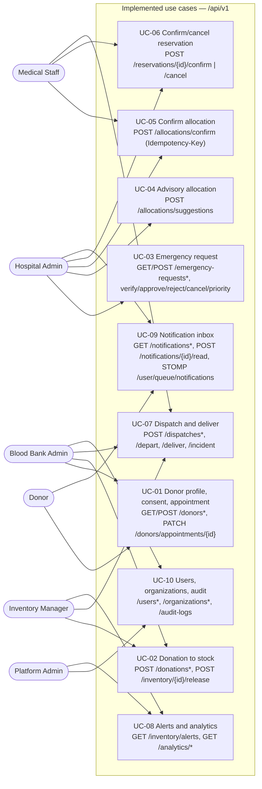
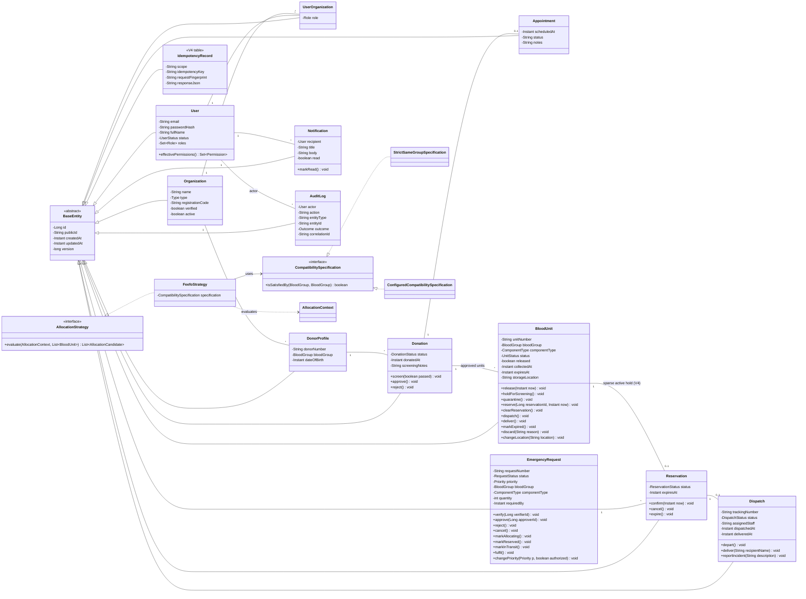
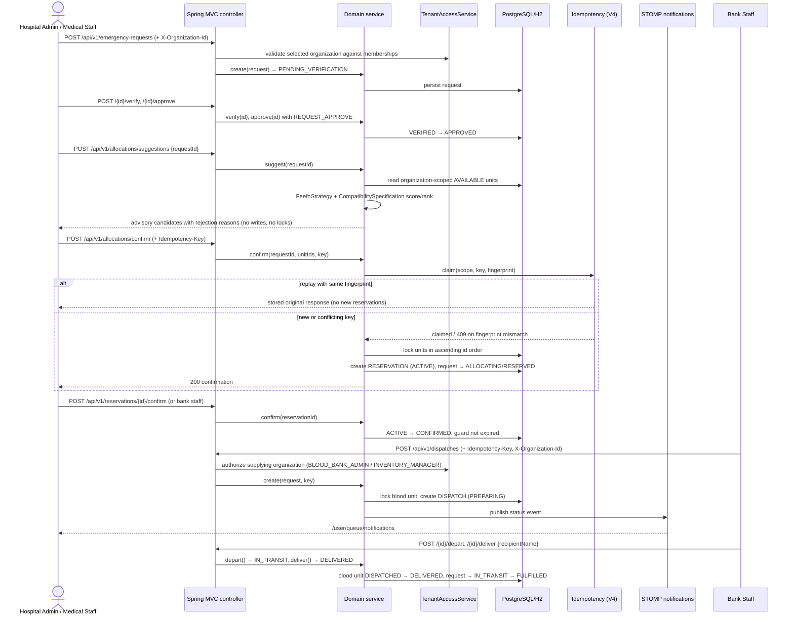
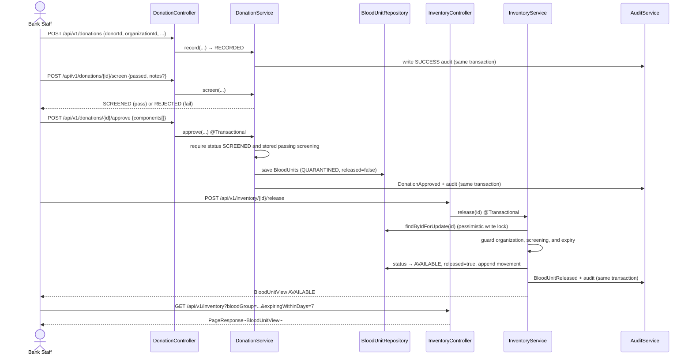
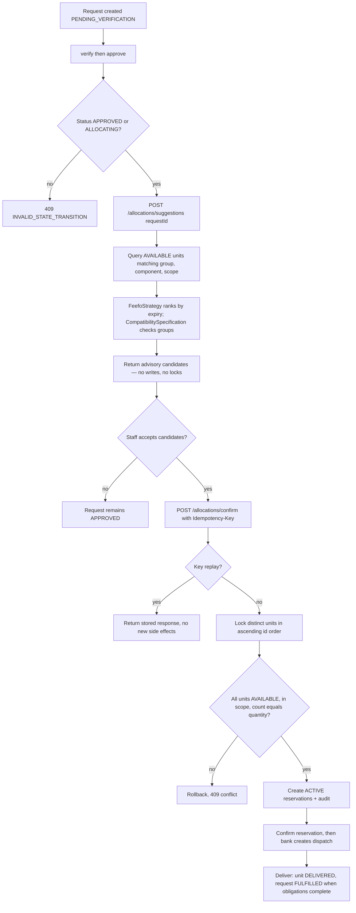
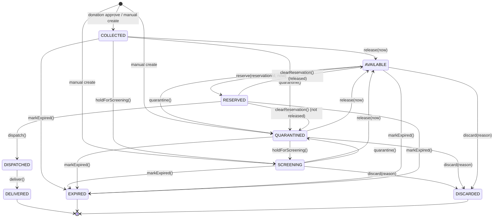
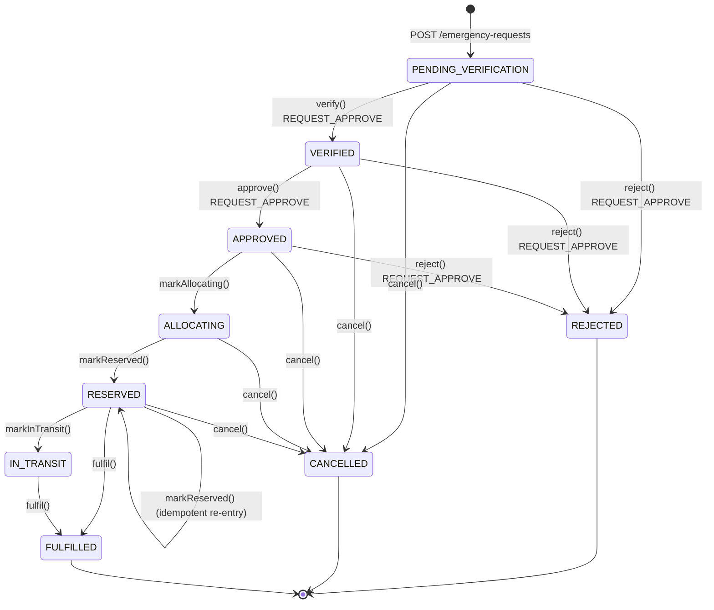
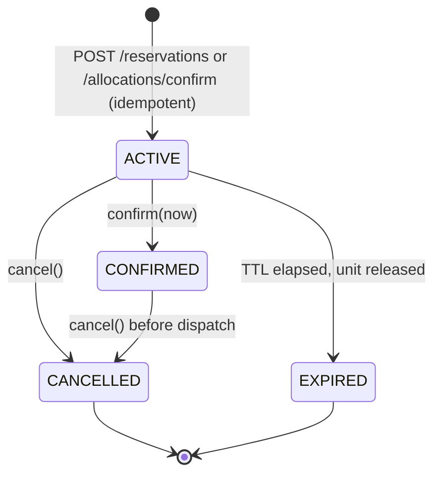
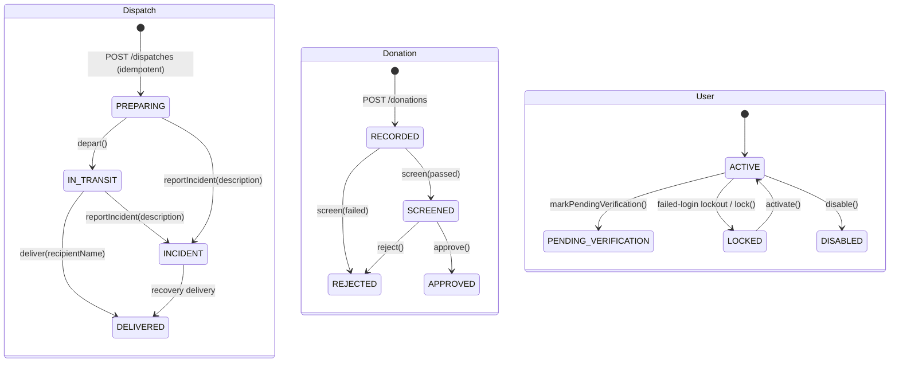

# LifeLink UML Views

Date: 2026-11-23
Status: implementation-aligned working document

## Purpose

These diagrams describe the object model and call flows actually present in
`project/backend`. They are engineering reference material, not a production-readiness
claim. Enum literals and transitions match the source classes; Mermaid has no native
use-case/activity diagram type, so those views use labelled flowcharts. Where an
end-to-end behaviour has no recorded evidence, the caveat is explicit.

Verified evidence: entities and services under `project/backend/src/main/java/com/lifelink`,
Flyway migrations `V1`–`V5` (including persistent `users.token_version`),
`DevelopmentDataSeeder`, `SecurityConfig`, `StompAuthenticationInterceptor`, the recorded
checks in [`../quality/TEST_RESULTS.md`](../quality/TEST_RESULTS.md), and the durable
evidence under [`../evidence/`](../evidence/). Current release status is authoritative
in [`../reviews/PHASE_2_FINAL_REVIEW.md`](../reviews/PHASE_2_FINAL_REVIEW.md). External
HTTP behaviour is authoritative in [`API_CONTRACTS.md`](API_CONTRACTS.md).

---

## 1. Use-case view

Role permissions are enforced server-side. Dispatch creation is a blood-bank action in
the supplying organization; hospital membership alone never grants it.

---

## 2. Class diagram — key domain types

`IdempotencyRecord` is the `V4__integrity_and_idempotency.sql` table used by
`ReservationService.Idempotency`. Uniqueness is `(scope, idempotency_key)`; the request
fingerprint and original serialized response are stored with the claim.

Allocation uses the real Strategy/Specification classes shown below; there is no
`BloodUnitFactory`/`DonationUnitFactory` — approved-unit creation lives in
`DonationService`. `FeefoStrategy` orders candidates first-expiry-first-out and uses a
`CompatibilitySpecification` for blood-group matching. The default implementation is
`StrictSameGroupSpecification`; `ConfiguredCompatibilitySpecification` is an optional
rule set enabled by `lifelink.allocation.compatibility-mode=CONFIGURED`. All advisory
scoring is non-clinical and makes no state changes.

---

## 3. Sequence — request to dispatch

Implemented behaviour reflected here:

- `X-Organization-Id` is validated against memberships by `TenantAccessService`; it
  narrows data access and never bypasses role permissions.
- Allocation confirmation, reservation creation, and dispatch creation bind the
  `Idempotency-Key` to a canonical request fingerprint. Replays return the stored
  response; same key with a different payload is `409`. Header/body divergence at
  allocation confirmation is `400 VALIDATION_ERROR`.
- Lock acquisition/integrity conflicts map to `409 CONCURRENCY_CONFLICT`; allocation
  locks are sorted by unit id.
- STOMP CONNECT requires a `Bearer` JWT in the native `Authorization` header; SUBSCRIBE
  is restricted to the caller's own queue with `NOTIFICATION_READ`; `/app` SEND frames
  are denied because no `@MessageMapping` handler exists. No raw passcode is accepted.
  Live STOMP delivery through the Compose nginx proxy is **verified**: a standalone Node
  smoke script obtained authenticated `CONNECTED` and a notification `MESSAGE`
  ([`../evidence/STOMP_SMOKE_RESULT.json`](../evidence/STOMP_SMOKE_RESULT.json)). The SPA
  itself still has no live STOMP client; notifications are shown via the REST inbox.

---

## 4. Sequence — donation to inventory

Audit `SUCCESS` rows participate in the business transaction, so they cannot survive a
rollback. Lifecycle notification processing is fault-isolated per item.

---

## 5. Activity — allocation advisory flow

---

## 6. State — BloodUnit

Actual literals in `BloodUnit.Status`: `COLLECTED`, `SCREENING`, `QUARANTINED`,
`AVAILABLE`, `RESERVED`, `DISPATCHED`, `DELIVERED`, `EXPIRED`, `DISCARDED`. V4 adds a
sparse unique index so at most one active reservation exists per unit.

---

## 7. State — EmergencyRequest

Actual literals in `EmergencyRequest.Status`: `DRAFT`, `PENDING_VERIFICATION`,
`VERIFIED`, `APPROVED`, `ALLOCATING`, `RESERVED`, `IN_TRANSIT`, `FULFILLED`, `REJECTED`,
`CANCELLED`, `EXPIRED`. `DRAFT` and `EXPIRED` are persisted literals; new requests start
at `PENDING_VERIFICATION`. Dispatch incidents are tracked by `Dispatch.Status.INCIDENT`,
not by a request status.

---

## 8. State — Reservation

Actual literals in `Reservation.Status`: `ACTIVE`, `CONFIRMED`, `CANCELLED`, `EXPIRED`.
There is no `PENDING` or `FULFILLED` reservation status.

---

## 9. State — Dispatch, Donation, and User

Actual literals: `Dispatch.Status` = `PREPARING`, `IN_TRANSIT`, `DELIVERED`, `INCIDENT`;
`Donation.Status` = `RECORDED`, `SCREENED`, `APPROVED`, `REJECTED`;
`User.Status` = `ACTIVE`, `PENDING_VERIFICATION`, `LOCKED`, `DISABLED`.

---

## 10. Deployment view

Local Compose deployment is implemented: backend and frontend images
`lifelink/backend:dev` and `lifelink/frontend:dev` were built successfully. Compose binds
PostgreSQL, backend, and frontend to `127.0.0.1` with overridable
`POSTGRES_PORT`/`BACKEND_PORT`/`FRONTEND_PORT`. Startup requires `JWT_SECRET`, and the
local demo stack sets `SEED_DEMO_DATA=true`. See
[`../deployment/DEPLOYMENT_GUIDE.md`](../deployment/DEPLOYMENT_GUIDE.md) for exact
commands. Public/production TLS, secrets management, and image pinning are not claimed.
