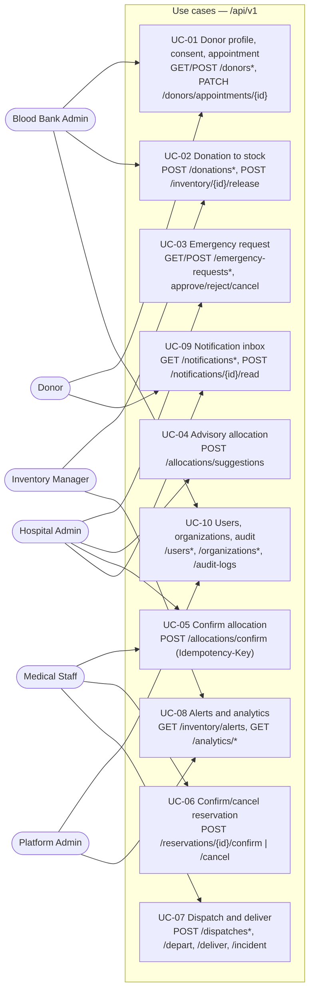
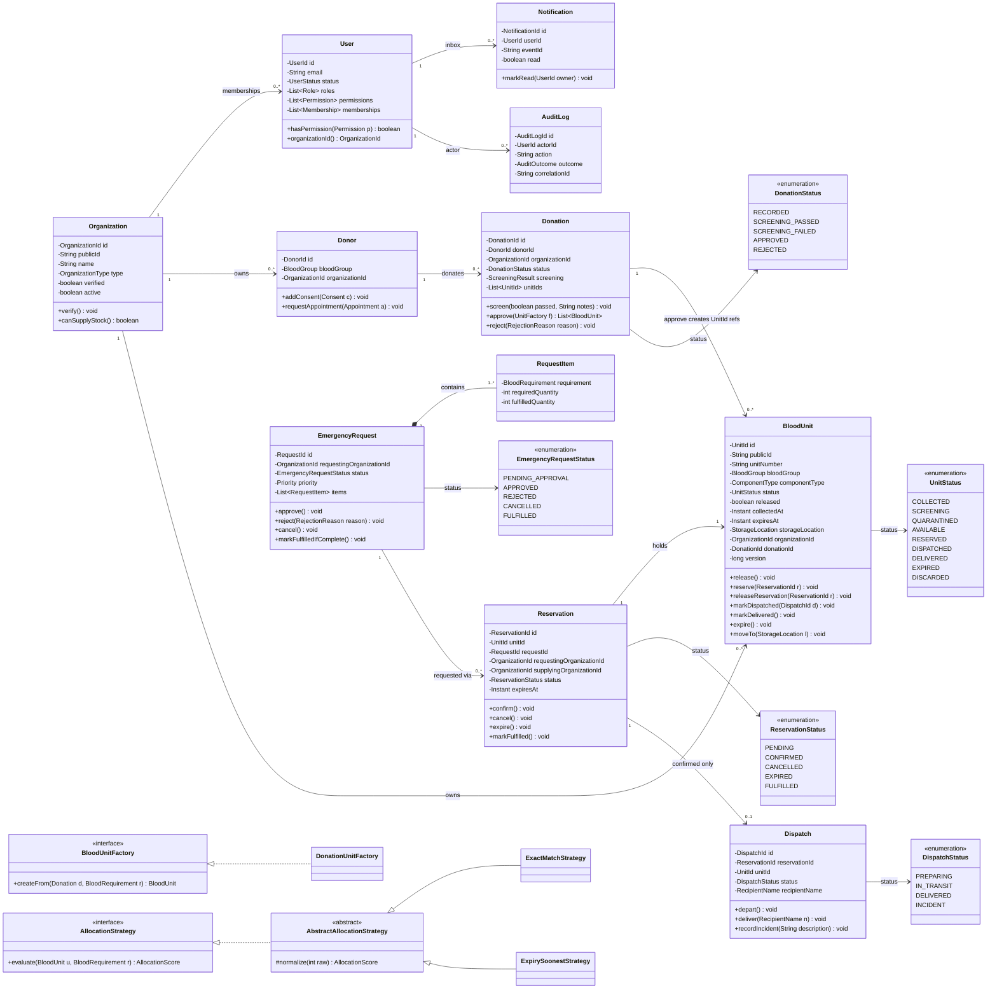
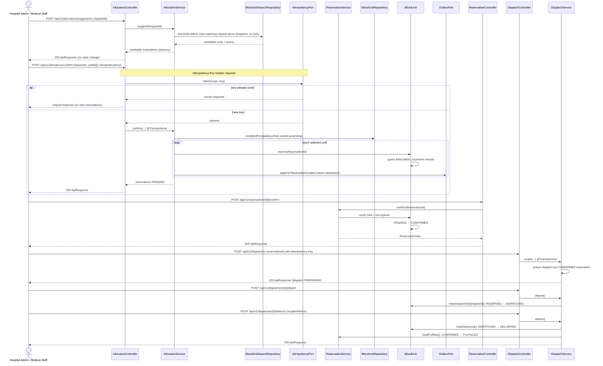
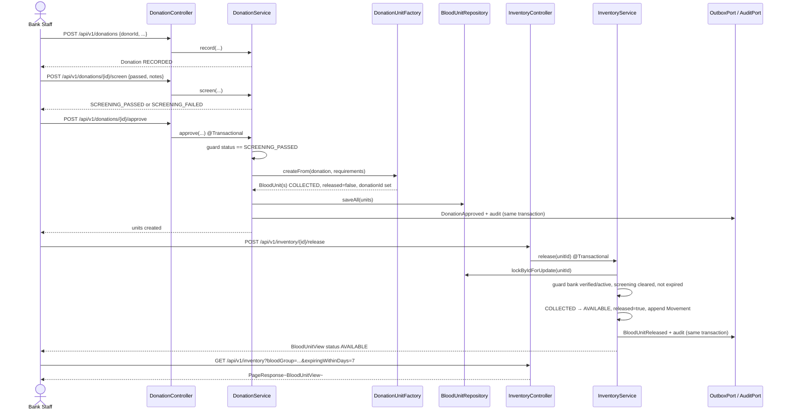
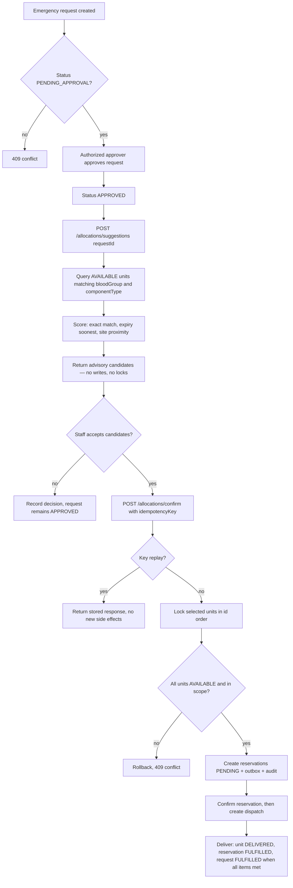
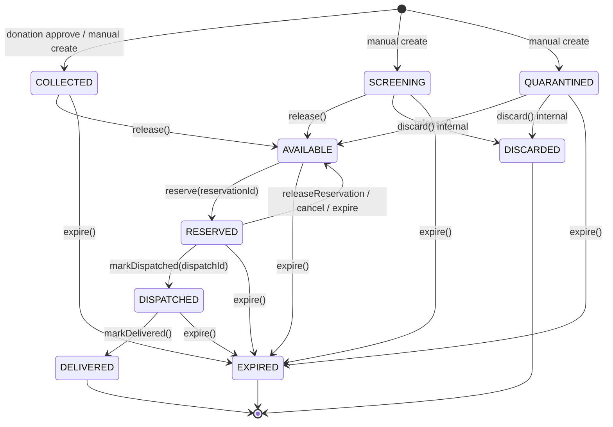
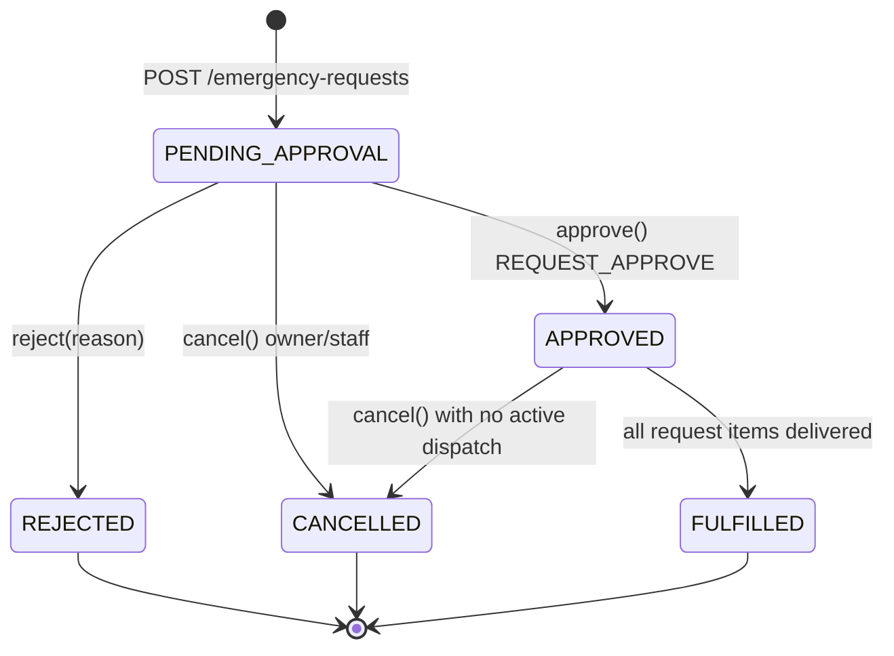
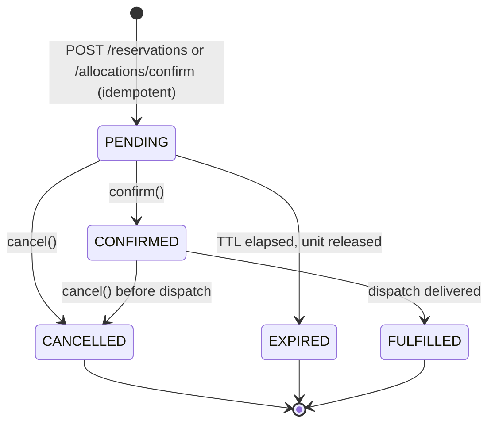

# LifeLink UML Views

**Status:** Planned design diagrams. They mirror [`DOMAIN_MODEL.md`](DOMAIN_MODEL.md) and [`API_CONTRACTS.md`](API_CONTRACTS.md). Mermaid has no native use-case/activity diagram type, so those views use labelled flowcharts. Enum literals are the exact contract/internal names from the domain model.

---

## 1. Use-case view

---

## 2. Class diagram — key domain types

`DonationUnitFactory` realizes `BloodUnitFactory`; `ExactMatchStrategy` and `ExpirySoonestStrategy` inherit common scoring from `AbstractAllocationStrategy`, which realizes `AllocationStrategy`.

---

## 3. Sequence — reservation flow (allocation confirm → confirm → dispatch)

---

## 4. Sequence — donation to inventory

---

## 5. Activity — allocation advisory flow

---

## 6. State — BloodUnit

---

## 7. State — EmergencyRequest

---

## 8. State — Reservation

